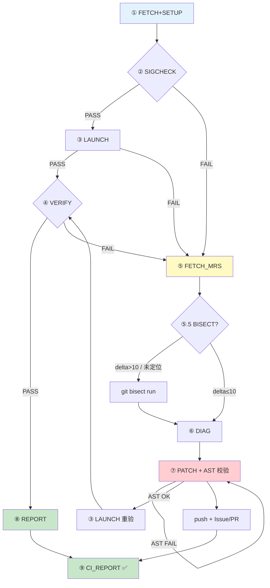

# MegatronAdaptor 夜间验证

## 背景

本 Skill 涉及的三个组件形成一条 **上游框架 → 适配层 → 硬件后端** 的依赖链：

```
Megatron-LM          ──→  MegatronAdaptor   ──→  TransformerEngineNPU   ──→  昇腾 NPU
(NVIDIA 训练框架)         (适配胶水层)            (NPU 版 TE 算子)            (华为硬件)
```

| 组件 | 定位 | 在本项目中的角色 |
|---|---|---|
| **Megatron-LM** | NVIDIA 开源大模型分布式训练框架 | **仅 clone 作为代码参考**。原生依赖 CUDA，NPU 上无法安装，仅通过 PYTHONPATH 引用源码 |
| **MegatronAdaptor** | 适配胶水层 | `register_patch(orig_func, wrapper)` 运行时 monkey-patch MLM：替换 CUDA-only 路径、适配 TE API 签名变更、stub 新引入的 CUDA 特性 |
| **TransformerEngineNPU** | TE 的昇腾 NPU 移植版 | 实际运行时后端，将 TE CUDA 融合算子替换为 `torch_npu` 等价实现 |

**核心冲突**：Megatron-LM 上游更新不考虑 NPU 兼容性，而 MegatronAdaptor 需要配套的 MLM + TE-NPU 才能在 NPU 上工作。一旦上游合入 breaking change，训练就会挂掉。

**因此需要每天拉取三个仓库的最新代码跑通训练**——在上游变化当天发现并定位问题 MR，生成适配 patch，保障每天都有可用的 MegatronAdaptor。

## 环境要求

- 所有 Python 脚本必须在指定 Conda 环境运行（`conda run -n <env>` 或先 `conda activate`）
- torch + torch_npu 由 Conda 预装；MegatronAdaptor / TransformerEngineNPU 构建时 `pip install -e`；**Megatron-LM 不安装**（仅 clone 用于代码参考和 import 注入）
- **三仓库分支配套关系 + 对应 Conda 环境 → `scripts/branch_matrix.json`**（唯一权威来源；不指定分支时默认 `ma_agent_py312`，对应 MLM/MA/TE 均 `main`）

## 输入

Skill 启动时问用户两个问题：

**问题 1**：上一次验证 OK 的 Megatron commit 是？
- A：用户输入 commit id（精确指定 delta 起点）；B 默认：取飞轮最近一次成功记录的 commit，无记录则取昨天 0 点后第一个 merge commit

**问题 2**：待调试 / 验证的 Megatron commit 是？
- A：用户输入 commit id；B 默认：取 `origin/main` 最新 commit

两个 commit 之间的 MR 就是本次需要关注的变更 delta。用户不回答则全自动——默认昨天 0 点版本 OK，最新版本待验证。

两个 commit id 保存到 `env_report.json`（`last_good_commit` + `target_commit`），后续步骤 ⑤ FETCH_MRS、⑥ DIAG、⑧ REPORT 均从此文件读取。

## 核心逻辑

**上一次验证 OK 的版本 → 当前的版本失败 → delta = 可能引入问题的 Megatron MR。**

失败后获取这些 MR 的 diff，帮助 LLM 精确定位哪些 MR 引入了变更导致 NPU 训练失败（TE 特性不兼容、API 签名变更、新增 CUDA-only 路径等），然后生成适配 patch。**目标是保障每天有可用的 MegatronAdaptor，配套最新社区 Megatron + TE-NPU，能在 NPU 上跑通训练。**

## Pipeline



**核心循环**：①→④ 跑通 → last_good 前移 → 下次 delta 窗口更小。①→④ 失败 → ⑤→⑦ 定位修复 → ③ 重验 → 通过后 last_good 前移，同时案例库 +1。**飞轮每转一圈，系统就更聪明一点。**

**每分支独立完整循环**：每个分支组合串行执行 ①→⑧ 的完整飞轮，失败时在同一上下文中立刻进入诊断修复，避免跨阶段序列化造成的信息损失。每分支设超时（默认 60 分钟），防止单分支异常阻塞后续分支。

**单分支致命性**：③ LAUNCH 第一步 ENVCHECK 发现 NPU 被其他训练任务占用 → **SKIP**（`overall="skip"`，不跑用例、不触发 ⑤⑥⑦⑧、不建 Issue/PR——环境问题非代码回归，跑了只会产出假失败）。① FETCH 失败 → FATAL，跳过该分支。② SETUP 失败分两类：**import 冒烟失败**（`adaptor_import_smoke=false`，代码级破坏，如上游 CUDA-only import 路径）→ 路由到 ⑤→⑥ 自动诊断修复；**环境类失败**（pip 安装 / NPU / dataset / TE 缺失）→ FATAL，跳过。② SIGCHECK / ③ LAUNCH / ④ VERIFY 失败 → NON-FATAL，记录后继续走完当前阶段收集完整上下文，随后立即进入 ⑤→⑥→⑦→③ 诊断修复循环。

### 步骤总览

| 步骤 | 脚本 | 产出 | 失败去向 |
|---|---|---|---|
| ① FETCH+SETUP | `nightly_fetch.py` + `nightly_setup.py` | `env_report.json`, `setup_report.json` | FETCH FATAL；SETUP import 冒烟失败 → ⑤，环境类 FATAL |
| ② SIGCHECK | `nightly_sigcheck.py` | `sigcheck_report.json` | FAIL → ⑤ |
| ③ LAUNCH | `nightly_launch.py`（首步 ENVCHECK） | `training_log.json`, `envcheck_report.json` | env_busy → SKIP；否则 NON-FATAL → ④ |
| ④ VERIFY | `nightly_verify.py` | `verify_report.json` | FAIL → ⑤ |
| ⑤ FETCH_MRS | `fetch_mrs.py` | `diff_report.json` | → ⑤.5 或 ⑥ |
| ⑤.5 BISECT | `git bisect run` | `bisect_report.json` | → ⑥ |
| ⑥ DIAG | `nightly_diag.py` + LLM | `diag_report.json` | → ⑦ |
| ⑦ PATCH | `nightly_patch*.py` + LLM | patch + commit + PR | 重验 → ③ |
| ⑧ REPORT | `nightly_report.py` | `final_report.json` | 追加飞轮 |
| ⑨ CI_REPORT | `push_sync_ci_results.py` | 推送 CI 代码仓 | — |

**各步骤完整 bash 命令 + 手动执行模板 → `references/operations.md`**（进入对应阶段前读取该文件相应小节）。

### ① FETCH+SETUP
拉取三个仓库（MLM 仅 clone 不安装）、checkout 到对应分支、记录 commit SHA。`--last-good` 为 delta 起点。`pip install -e` MegatronAdaptor + TransformerEngineNPU，设置 NPU 环境变量，检查 NPU 和数据集可用性。末尾 `import megatron_adaptor` 冒烟测试（超时 120s，取决于 NPU 初始化速度）。失败即终止该分支。

### ② SIGCHECK
AST 解析 MegatronAdaptor 中所有 `register_patch(orig_func_name, ...)` 调用，用 `inspect.signature` 校验 Megatron 当前函数签名是否匹配。有变更 → 阻断 LAUNCH，同时触发 ⑤→⑥→⑦ 修复流程。

### ③ LAUNCH
**第一步 ENVCHECK（NPU 占用预检）**：检测共享 NPU 是否被**其他用户的训练任务**占用——避免烧完 45 个用例后得到 45/45 假失败 + 空 Issue/PR。冒烟测试只做单进程 device init、不初始化 HCCL 集合通信/不绑定端口，不受影响；真正撞 `hcclCommInitRootInfoConfig error 7` + `EI0020` 的是分布式的训练 LAUNCH，因此在 LAUNCH 第一步拦截最合适。判定信号（任一命中即 `occupied`）：
1. **HCCL NPU socket 端口已绑定**（默认 16666；遵循 `HCCL_NPU_SOCKET_PORT_RANGE`）——`ss -ltn`
2. **其他用户训练进程**（非 `ma_daily_ci`/root 属主；训练入口名级别模式：`torchrun` / `torch.distributed.run` / `pretrain_gpt` / `trainer.py` / `mindspeed` / `run_pretraining` / `megatron/pretraining`）——`ps -eo user,args`
3. npu-smi 摘要仅作人工上下文，**不单独判定**

occupied 时：`nightly_launch.py` 写 `env_busy=true` 的 `training_log.json` 返回 0，编排器把该分支标为 `overall="skip"`、`needs_llm_diag=false`，不跑用例、不触发 ⑤⑥⑦⑧、不建 Issue/PR；CI 报告显示 ⏭️ SKIP（原因含占用者 user + 端口）。全部分支 skip 时编排器 exit 2。预检脚本本身失败 → 视为 free 继续（绝不因探针故障阻断夜航）。⚠️ 训练模式必须是脚本/可执行名级别，不能用裸 `megatron`/`fsdp`/`pretrain` 子串——skill 路径含 `megatron-adaptor-sync`，宽模式会让 root 包装进程（cron 守卫 su）cmdline 误报 occupied。

> 案例：2026-08-21 admin123 的 `mindspeed_mm` 全量训练 03:47 启动占满 8 卡 + 端口 16666，夜航 45/45 全挂 `hcclCommInitRootInfoConfig error 7` + `EI0020`。→ 见 memory `npu-occupied-port-16666-nightly-case`。

ENVCHECK 通过后：读取 MA 仓当前分支 `test/system_tests/test_cases.txt`（用例注册随分支演进），逐个执行测试用例 bash 脚本。subprocess + 超时控制，stdout/stderr 全量落盘，正则提取 loss、throughput、iterations。**失败 = NON-FATAL**：记录错误后继续执行 ④ VERIFY，收集完整上下文供后续 DIAG 使用。

### ④ VERIFY **[始终执行]**
4 项确定性检查，秒级阻断：退出码全 0、loss 收敛（final < initial）、日志无 ERROR/Traceback/RuntimeError/OOM、吞吐量 >= 基线。VERIFY 始终执行（即使 LAUNCH 失败），确保收集所有失败信息供后续诊断使用。

### ⑤ FETCH_MRS（仅失败时）
获取 Megatron 从 `--last-good` 到 `--target` 之间合并的 commit 列表，扫描区间 diff，提取变更符号并与适配器已注册的 patch target 做交叉比对。**这组 commit 是今天的失败与昨天的成功之间唯一的变量。**

### ⑤.5 BISECT（仅失败时）→ 详见 `references/bisect_methodology.md`
触发条件：delta > 10 commits / last_good == target / 诊断未定位。使用 `git bisect run` 二分精确定位 breaking commit，结果直接喂入 ⑥ DIAG。

### ⑥ DIAG（仅失败时）— LLM 诊断
读取 ⑤ 的 MR diff（或 ⑤.5 的 bisect 结果）+ ④ 的失败日志 + 适配器 patch 结构。核心提问：「昨天 OK，今天失败。以下是引入问题的 commit diff（由 bisect 精确定位），分析变更如何导致 NPU 训练失败。」搜索空间压缩到单个 commit。

**诊断流程**：
1. **优先使用 bisect 结果**：若 ⑤.5 产出 `bisect_report.json`，以 `breaking_commit` 的 diff 作为第一诊断输入
2. 读取 `diag_prompt.txt` 和具体失败日志（`logs/<test_name>/stderr.log`），提取根因
3. 穿透 `ChildFailedError` 包装——找第一个真实的 Python 异常行
4. 交叉对比：同一用例在其他分支是否通过（区分分支差异 vs 普遍问题）
5. 分类决策：
   - **NPU 类型不匹配** → `_fix_npu_tensor_type` monkey-patch
   - **参数变化** → 更新 wrapper 签名或测试脚本
   - **CUDA-only 路径** → 用 `torch_npu` 等价实现替代或 stub
   - **TE API 兼容性** → 适配 TE 签名变更或 disable 新特性
   - **TE-NPU 偏离社区 TE 契约** → **先对标社区 TransformerEngine 参考实现判断归属**：社区 TE 在问题点的行为 = 基准契约。若 TE-NPU 偏离该契约且偏离可避免（如把本应 int 的 `group["step"]` 改成 device tensor 泄漏进 state_dict）→ 修复落在 **TE-NPU 仓**（保持与社区契约一致，runtime 语义不动）；MA 只在 TE-NPU 不可控时才做临时 shim。参考案例：FusedAdam step 序列化（2026-08-17，见 `references/case_library.md` 案例 3）
   - **逻辑变换错误**（De Morgan 违反、条件重构失误等）→ monkey-patch 补偿，不改原条件（其他调用方可能依赖新语义）
   - **上游源码 Bug（GPU/NPU 均受影响）** → MegatronFixFeature + CLI flag
   - **CANN/HCCL/NPU 环境问题** → 标记 NEEDS_HUMAN，跳过

> **⚠️ 诊断前必读**：5 个致命陷阱（假设派生关系、搜索错误特征、假设 NPU 不兼容、pre-commit 时序、**修复归属默认落 MA**——先对标社区 TE 参考实现）+ MegatronFixFeature vs MegatronBasicFeature 修复合入策略 + **复发防护**（跨天 reset 会打回 BasicFeature，已知 bug 复发先查 reflog）→ `references/diagnostic_pitfalls.md`

### ⑦ PATCH（仅失败时）— LLM 生成 + AST 校验 + 重验 + 推送
**输入**：`diag_report.json`（`breaking_mrs`、`root_cause`、`affected_patch_file`、`fix_summary`）、报错涉及的 Megatron 源文件、对应适配器 patch 文件。

**打 patch 策略**（按优先级）：
- 签名变更 → 更新适配器 wrapper 的参数列表
- 新 TE API 无 NPU fallback → `torch_npu` 等价实现替代，或 disable 该特性
- CUDA-only 融合算子 → torch 原生 NPU 等价版本，或 `create_dummy` 跳过
- 新 TE config 选项 → `TransformerConfig` wrapper 中添加 stub 或放宽检查
- **TE-NPU 偏离社区契约** → 直接改 **TransformerEngineNPU 仓**（对标社区 TE 参考实现，如 `state_dict()` 里把 tensor step 序列化成 int），本地分支提交 → 推个人 fork → 对 Ascend 上游发 PR；MA `patches/` 仅当 TE-NPU 不可控时作临时 shim，TE-NPU 修复合入后**必须移除 MA shim 防双写**。→ 完整提交流程见 `references/operations.md`「TE-NPU 契约修复提交」
- **⚠️ 上游源码 Bug（GPU/NPU 均受影响）→ MegatronFixFeature + CLI flag**

**⚠️ `register_patch` 命名约定**：`patch_manager` 通过函数名区分 wrapper 和 replacement——
- 函数名以 **`_wrapper`** 或 **`decorator`** 结尾 → 装饰器模式 `wrapper(original_fn)` → 返回包装后函数
- 函数名不以这两者结尾 → **直接替换模式**：`new_func` 直接替换 `original_fn`，不再传入原函数
- **违反此约定会报 `got an unexpected keyword argument`**（patch_manager 把 wrapper 当成直接替换直接调用）
- 需要包装原函数时，函数名必须加 `_wrapper` 后缀

**⚠️ 代码注释风格（agent 写 patch 必须遵守）**：注释**简洁明了**，只说"这段代码**做什么** + **为什么**这样写"，一两句即可：
- 函数 docstring 一句话说清目的；复杂的"为什么"用一行行内注释，不要多段 docstring
- **不写**历史背景 / 跨文件考证 / 上游 commit 溯源（这些放 Issue 评论或 DIAGNOSIS_AND_FIX.md，不进代码注释）
- **不重复**代码本身能表达的内容：优先清晰命名让代码自解释，注释只补充必要信息

**修复循环**（每失败用例最多 3 轮）：
1. 分析 breakage 类型，确定策略
2. 参考现有 patch 写法（读对应域 `megatron`/`transformer_engine`/`requirements` 下的现有 patch），生成代码写入 `megatron_adaptor/patches/<domain>/`
3. `nightly_patch.py` AST 校验 → 失败则 LLM 修复 → 重新校验
4. 重验前防御性校验：`git branch --show-current` 确认 MLM 在正确分支
5. `bash -e` 重验失败用例（日志落 `output/<YYYY-MM>/<MM-DD>/auto_fix/<branch>/<test>/`）
6. PASS → 标记 VERIFIED 跳出循环；FAIL → 读新日志，新错误继续修复，旧错误重复则调整方案
7. 3 次后仍失败 → 标记 NEEDS_HUMAN

**⚠️ 多轮修复的 commit 策略**：修复循环内**不推送到远程**。每轮修复后本地 commit（便于回退），但第 N 轮修正第 N-1 轮的 bug 时用 `git commit --amend` 替换上一轮有缺陷的 commit，确保最终只有**一个干净 commit**。所有用例修复完成且回归检查通过后，才一次性 force push。

> 多轮修复中代码为什么会变 → `references/patch_iteration_principles.md`

**重验 / 回归检查 / 提交推送 / create_issue_pr.py 幂等工作流的完整命令 → `references/operations.md`**

**gitcode API 用法 → `references/gitcode_api_guide.md`**（幂等建 Issue/PR，LLM 不要手工 curl 创建——历史教训）

**修复完成后**：诊断分析 + 修复总结必须写入 `output/<YYYY-MM>/<MM-DD>/DIAGNOSIS_AND_FIX.md` → 写作规范见 `references/diag_report_writing_guide.md`（12 条硬性要求 + 字数底线）。**报告正文必须用中文撰写**；代码、diff、日志摘录保留原文（不翻译）。

**修复后的 Issue/PR 闭环**：修复验证通过并推送后，必须跑 `create_issue_pr.py --date <date>` 幂等建 Issue + PR。**Issue 粒度 = 问题级**（同一归一化根因跨分支/用例/天只建一个，其余追加每日评论；标题 `[daily-ci] <根因>`，去重逻辑见 `references/gitcode_api_guide.md`）。**⚠️ 手动 / agent 驱动路径（非 cron needs_llm_diag 路径）需先补两步前置**，否则脚本对 `needs_llm_diag=false` 分支直接跳过，或缺 `fixed_tests.json` 时「仅处理 PR」不建 Issue（2026-08-14 test_activation_variants 即因此只有 PR #94 而无 Issue）：
1. 写 `output/<YYYY-MM>/<MM-DD>/<branch>/state/fixed_tests.json` —— 本次**确认修复的真问题**测试名列表（如 `["test_activation_variants"]`），只列已确认修复的训练 bug，排除 verify 误报
2. 确认 / 置位 `output/<YYYY-MM>/<MM-DD>/combined_summary.json` 中该分支 `needs_llm_diag=true`（手动重建 combined_summary 时置位）
然后再跑 create_issue_pr.py。→ 完整命令见 `references/operations.md`「创建 Issue + PR」。

### ⑧ REPORT
读取所有 artifact，合成 `final_report.json`，追加飞轮：成功时记录 commit SHA（下次 delta 起点），失败时记录 breaking MRs + patch。计算 N001~N006 evals，阈值门控。

### ⑨ CI_REPORT
自动读取 ⑧ REPORT 产出，合成 Markdown 报告并推送到 CI 代码仓：

```
读取 combined_summary.json + 各分支 state 文件
  → 合成 Markdown 汇总报告 (SYNC_SUMMARY)
  → 归档 DIAGNOSIS_AND_FIX.md（如存在）
  → 一并推送 nightly_case_library.jsonl（构建结果历史，稳定路径覆盖写）
  → 推送到 CI 代码仓 sync_build_results/YYYY-MM/MM-DD/
```

CI 代码仓凭据（token、URL、本地目录）统一从 `scripts/.push_config.json` 读取，脚本自动构建认证 URL。`.push_config.json` 含 token 不入仓：首次使用复制 `scripts/.push_config.example.json` 为 `.push_config.json` 并填入真实值（模板含各字段说明）。
案例库（`nightly_case_library.jsonl`）为**运行数据，已脱离代码仓 git 跟踪**（见 MA-agent `.gitignore`）：本地副本仍供 ① FETCH / ⑥ DIAG 运行时读取，构建结果历史随本次推送归档至 CI 仓 `sync_build_results/nightly_case_library.jsonl`；其中 `case` 诊断知识已固化至 `references/case_library.md` 随 skill 版本化。

## 关键设计

- **压自由度：delta 压缩搜索空间**——LLM 诊断的不是「Megatron 全量代码 + 日志」，而是「24 小时内的 MR diff + 日志」，搜索空间从整个代码库压缩到十几个 MR
- **左移：四层秒级阻断**——L0 ③ LAUNCH 首步 ENVCHECK（NPU 被占即 SKIP，<2s）→ L1 ① FETCH+SETUP 冒烟（最多 120s）→ L2 ② SIGCHECK 签名校验（5s）→ L3 ④ VERIFY 日志检查（1s）
- **共享 clone + PYTHONPATH 隔离**——多分支共享 `/home/ma_daily_ci/workspace/` 下三个仓库的 clone，每分支通过 `git reset --hard` + `git clean -fd` + `git checkout --force origin/<branch>` + `git pull` 切换；`nightly_orchestrator.py` 在 source `setup_env.sh` 后额外 prepend `$WORK_DIR/Megatron-LM` 到 `PYTHONPATH`
- **冒烟测试错误提取**——`nightly_setup.py` 在 import 失败时从 stderr **逆向扫描**已知异常类型（stderr 最末尾往往是无关的 `DeprecationWarning`，真正异常在 traceback 中间）
- **飞轮双向回流**——成功 → 记 commit SHA → delta 缩小 → 诊断更精准；失败 → 记失败+MR+诊断+patch → 案例库积累 → 修复加速。两股力量共同加速飞轮

## Evals

| ID | 名称 | 阈值 | 轴 |
|----|------|------|-----|
| N001 | nightly_run_success_rate | 0.95 | 对不对 |
| N002 | setup_success_rate | 0.95 | 对不对 |
| N003 | test_pass_rate | 0.90 | 对不对 |
| N004 | no_false_pass | true | 对不对 |
| N005 | report_latency | 3600s | 费不费 |
| N006 | diagnosis_accuracy | 0.70 | 费不费 |

## 调度

- **Cron 自动化**：由外部编排脚本驱动，确定性执行 ①→④→⑧，仅 `needs_llm_diagnosis > 0` 时触发 ⑥ DIAG → ⑦ PATCH → ③ 重验
- **手动**: `/megatron-nightly`（Claude agent 驱动全流程，含诊断修复）

## 多分支构建

- 每个分支组合串行跑完整飞轮 ①→⑧；大部分情况下 ①→④ 直接通过，不触发诊断
- 每分支 **60 分钟超时**，超时则终止该分支、记录失败、继续下一分支，防止单分支异常阻塞整个流水线
- Cron 自动化路径中，`nightly_orchestrator.py` 直接由 bash 脚本调用（非 `claude -p`），确保 artifacts 确定性产出；Claude 仅在诊断修复阶段介入
- **失败传播**：每分支间自动清理残留进程。③ LAUNCH 首步 ENVCHECK env_busy → 该分支 SKIP（`overall="skip"`，非代码失败，不诊断）→ 继续下一分支；全部分支 SKIP 时编排器 exit 2。单分支 FETCH/SETUP 失败（致命）→ 跳过 → 继续下一分支；SIGCHECK/LAUNCH/VERIFY 失败（非致命）→ 进入 ⑤→⑥→⑦ → ③ 重验 → ⑧ → 继续下一分支。`combined_summary.json` 汇总所有分支状态（含 `skipped` 计数），任一分支最终失败则整体标记失败
- 分支组合表 → `scripts/branch_matrix.json`

### 状态隔离

```
/home/ma_daily_ci/workspace/
├── Megatron-LM/                ← 共享 clone，每分支切换 ref
├── MegatronAdaptor/            ← 共享 clone，每分支切换 ref
├── TransformerEngineNPU/       ← 共享 clone，始终 main
└── output/
    ├── YYYY-MM/                ← 按月分层
    │   └── MM-DD/              ← 按日隔离（同一天重跑自动归档为 MM-DD_rN）
    │       ├── main/state/     ← envcheck_report.json, env_report.json, training_log.json, ...
    │       ├── core_r0.17.0/state/
    │       ├── core_r0.18.0/state/
    │       └── combined_summary.json
    └── logs/
        └── YYYY-MM/
            └── MM-DD/
                ├── cron_nightly.log    ← 脚本自管重定向（crontab 不重定向）
                └── claude_prompt.txt   ← 诊断 prompt（Step 2 后删除）
```

## 文件

```
scripts/
├── setup_env.sh                   ← Conda + CANN 环境初始化
├── nightly_orchestrator.py        ← 多分支编排（入口）
├── nightly_envcheck.py            ← ③ LAUNCH 首步 ENVCHECK（NPU 占用预检：HCCL 端口 + 其他用户训练进程）
├── nightly_fetch.py              ← ① FETCH（三仓库 clone + git pull）
├── nightly_setup.py              ← ① SETUP（pip install -e MA+TE-NPU + 冒烟测试）
├── nightly_sigcheck.py           ← ② 签名交叉校验
├── nightly_launch.py             ← ③ LAUNCH（首步 ENVCHECK + WITH TE + 失败重试）
├── nightly_verify.py             ← ④ VERIFY（4 项日志检查）
├── fetch_mrs.py                  ← ⑤ git diff 扫描 + 交叉比对
├── nightly_diag.py               ← ⑥ DIAG（LLM 诊断 prompt 构建）
├── nightly_patch_gen.py          ← ⑦ PATCH（修复 prompt 构建）
├── nightly_patch.py              ← ⑦ PATCH（AST 语法校验）
├── verify_patch.py               ← ⑦ PATCH（完整性校验）
├── nightly_report.py             ← ⑧ REPORT + 飞轮
├── nightly_eval_set.json         ← Evals 阈值配置
├── nightly_case_library.jsonl    ← 飞轮案例库（运行数据，已脱离 git 跟踪；随 ⑨ 推送 CI 仓）
├── branch_matrix.json            ← 分支配套（唯一权威，orchestrator/push_sync 读此）
├── push_sync_ci_results.py       ← ⑨ CI 报告推送
├── nightly_sync_and_report.sh    ← Cron 编排入口
├── .push_config.example.json     ← 配置模板（字段说明，可提交；复制为 .push_config.json 使用）
└── .push_config.json             ← 个人仓凭据（含 token，已被 .gitignore 排除，不发布；由模板复制生成）
```

## references 索引

| 文件 | 内容 | 何时读取 |
|---|---|---|
| `scripts/branch_matrix.json` | 分支配套（唯一权威） | 启动时 |
| `references/operations.md` | 手动执行 / 重验 / 推送完整命令 | ⑦ 及手动执行阶段 |
| `references/diagnostic_pitfalls.md` | 5 个致命陷阱 + 修复合入策略 + 复发防护 + TE-NPU 契约归属 | ⑥ 诊断前必读 |
| `references/bisect_methodology.md` | git bisect 方法论 | ⑤.5 触发时 |
| `references/patch_iteration_principles.md` | 多轮修复演进原理 | ⑦ 多轮修复时 |
| `references/diag_report_writing_guide.md` | DIAGNOSIS_AND_FIX.md 写作规范 | ⑦ 完成后 |
| `references/gitcode_api_guide.md` | gitcode API + 幂等建 Issue/PR | ⑦ 推送时 |
| `references/case_library.md` | 诊断知识固化（case 记录，随 skill 版本化） | ⑥ 诊断复盘时 |
