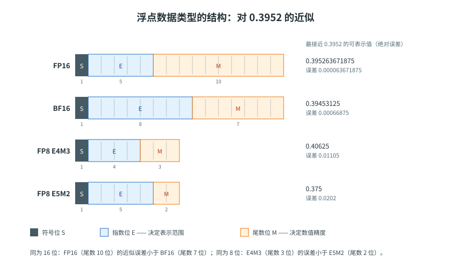
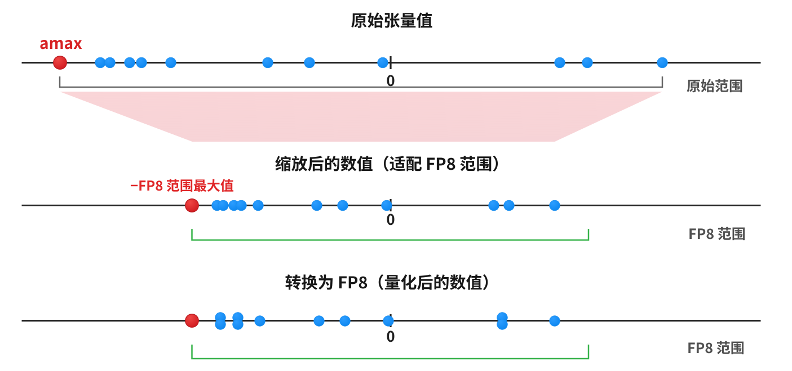
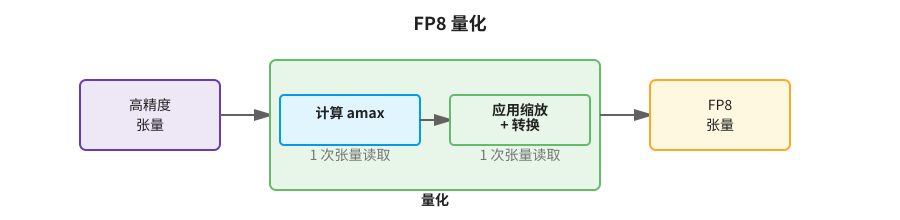
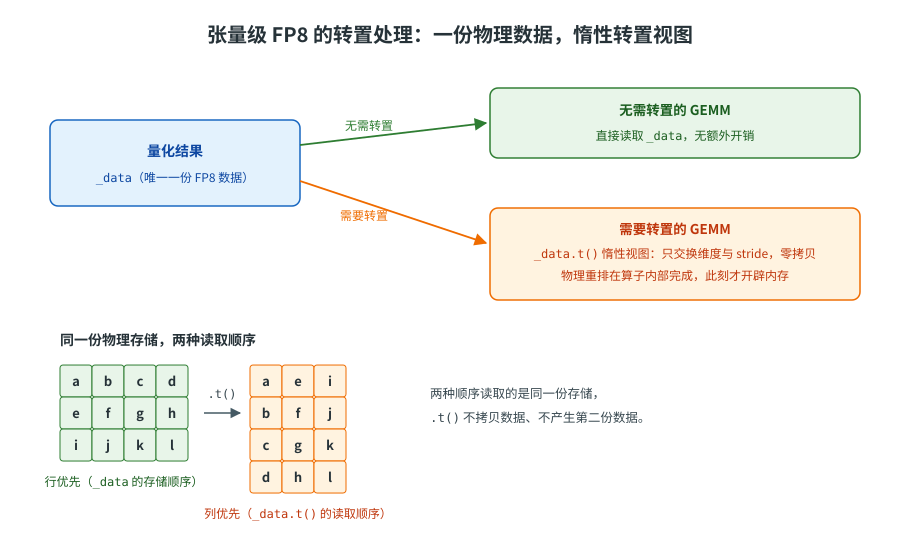
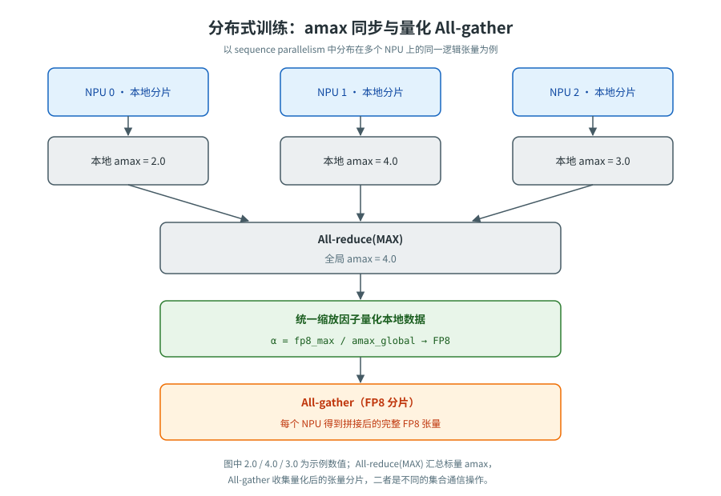

<!--
Copyright (c) 2022-2026, NVIDIA CORPORATION & AFFILIATES. All rights reserved.
Copyright (c) 2026, Huawei Technologies Co., Ltd. All rights reserved.
See LICENSE in the repository root for license information.
-->

# FP8 Current Scaling

FP8 Current Scaling 策略是 TENPU 提供的低精度策略。为了理解这种策略的工作原理，首先需要了解 FP8 数据类型，以及它与其他浮点格式的区别。

## FP8 数据类型

在 TENPU 中，FP8 数据类型实际上包含两种不同的数据格式，它们分别适用于神经网络训练的不同阶段：

- **E4M3** —— 由 1 个符号位、4 个指数位和 3 个尾数位组成。它能够表示绝对值最大为 448 的数值，以及 `NaN`。
- **E5M2** —— 由 1 个符号位、5 个指数位和 2 个尾数位组成。它能够表示绝对值最大为 57344 的数值，以及正负 `Inf` 和 `NaN`。扩大动态范围的代价是所存储数值的精度更低。

<p align="center"></p>

<p align="center">图 1：浮点数据类型的结构。右侧数值为各格式中最接近 0.3952 的可表示值；尾数位越多，近似误差越小。</p>

**训练中 E4M3 和 E5M2 的使用**

默认情况下，TENPU 采用混合使用两种格式的方式：

- *前向传播（Forward pass）* —— 激活值和权重需要更高的精度，因此使用 E4M3 数据类型进行存储。
- *反向传播（Backward pass）* —— 梯度对精度损失的敏感程度较低，但需要更大的动态范围，因此优先使用 E5M2 数据类型。

用户可以通过策略的 `fp8_format` 参数配置这一行为。

## 缩放因子

FP8 数据类型的动态范围有限，不足以直接表示许多张量中的数值。为了解决这一问题，需要对张量中的数值进行缩放。FP8 Current Scaling 策略为每个张量使用一个 **FP32** 缩放因子。张量元素 `x` 的 FP8 精度表示方式如下：

$$
x = x_{\mathrm{fp8}} \cdot s
$$

其中：

- `x_fp8` 是 FP8 数值（E4M3 或 E5M2）；
- `s` 是应用于整个张量的全局 **FP32** 缩放因子。

**FP8 Current Scaling 量化**

下面进一步了解 FP8 Current Scaling 策略如何通过缩放因子实现 FP8 量化。

<p align="center"></p>

<p align="center">图 2：FP8 量化三步：计算 <code>amax</code>、按 <code>fp8_max / amax</code> 将原始范围缩放到 FP8 范围、舍入到离散的 FP8 表示值；相近的数值会重叠在同一 FP8 刻度上。</p>

FP8 量化包括 3 个步骤：

1. 计算张量中元素绝对值的最大值，将其称为 `amax`。
2. 将缩放因子 `fp8_max / amax` 应用于张量，使其数值落入 FP8 的表示范围。
3. 将数值转换为相应的 FP8 格式。数值会被舍入到最接近的可表示 FP8 数值。

**性能分析**

量化是一项受内存带宽限制的操作：per-tensor 缩放必须先归约出整个张量的 `amax`，才能确定缩放因子并量化，因此数据需要被读取两次：

- 第一次读取：计算所有元素中的 `amax`。
- 第二次读取：应用缩放因子并转换为 FP8。

与通常只需要读取一次内存的其他策略相比，这会带来显著的额外开销。

<p align="center"></p>

<p align="center">图 3：使用 Current Scaling 策略进行 FP8 量化需要两次读取张量：一次用于计算 <code>amax</code>，另一次用于应用缩放因子并转换为 FP8。</p>

## 转置处理

### 昇腾 NPU 上的内存布局

BF16/FP16 张量可通过转置视图交给 GEMM；形状、连续性及对齐要求仍由所用算子决定。tensorwise FP8（`DelayedScaling` / `Float8CurrentScaling`）同样如此：量化结果只有一份 `_data`，不为转置方向保存第二份物理数据，需要转置时以 `.t()` 惰性视图表达——只交换维度与 stride，不拷贝数据、不分配内存。物理重排由底层算子在实际使用转置数据的那次 GEMM 中完成，转置开销由该次 GEMM 承担，量化过程不承担转置开销。

<p align="center"></p>

<p align="center">图 4：转置以 <code>.t()</code> 惰性视图表达，不产生第二份数据；物理重排推迟到 GEMM 算子实际使用转置数据时完成。</p>

## 分布式训练

**量化 All-gather**

TENPU 支持 FP8 All-gather：通信前先对张量执行量化，可显著减少需要传输的数据量。

**Amax 归约**

需要跨节点执行 All-gather 的张量（例如 sequence parallelism 中的输入和梯度），必须在量化之前同步 `amax`。每个节点先计算本地的 `amax`，随后通过归约操作获得所有节点中的全局最大值。所有节点使用同步后的 `amax` 计算相同的缩放因子，从而实现量化后的 All-gather。

<p align="center"></p>

<p align="center">图 5：先同步全局 <code>amax</code>，各 NPU 用统一缩放因子量化本地数据，再执行 FP8 All-gather；图中数值为示例。</p>

例如，在 sequence parallelism 等场景中，一个逻辑 Tensor 分布在多个节点或 Rank 上。假设直接让每个 NPU 用自己的局部 `amax`，如果随后把这些 FP8 分片汇聚成一个逻辑 Tensor，不同分片就不能按单一的统一 scale 计算。需要先做 amax 同步归约：

$$
a_{\max}^{\mathrm{global}}
=\max(a_{\max}^{(0)},a_{\max}^{(1)},\ldots,a_{\max}^{(P-1)})
$$

之后，各 Rank 使用统一的：

$$
\alpha=\frac{\mathrm{fp8\_max}}{a_{\max}^{\mathrm{global}}}
$$

再对本地数据量化并执行 All-gather。

## 支持的设备

Ascend 950 及更新设备。运行前可通过 `te.is_fp8_available(return_reason=True)` 检查当前 NPU 的支持情况。

## 示例

下面展示如何在 PyTorch 中使用 FP8 Current Scaling 策略：

**PyTorch**

```python
import torch
import torch_npu
import transformer_engine.pytorch as te
from transformer_engine.common.recipe import Float8CurrentScaling, Format

torch.npu.set_device(0)
available, reason = te.is_fp8_available(return_reason=True)
if not available:
    raise RuntimeError(reason)

# 可选格式：
#   - Format.HYBRID（默认）—— 前向 E4M3，反向 E5M2
#   - Format.E4M3 —— 前向和反向均使用 E4M3
recipe = Float8CurrentScaling(fp8_format=Format.HYBRID)

# 参数以 BF16 保存的线性层
layer = te.Linear(1024, 1024, params_dtype=torch.bfloat16, device="npu")
inp = torch.randn(32, 128, 1024, dtype=torch.bfloat16, device="npu")

with te.autocast(enabled=True, recipe=recipe):
    output = layer(inp)
    loss = output.sum()

# 反向在量化上下文外执行
loss.backward()
```

## 量化器

**PyTorch**

Current Scaling 使用 `Float8CurrentScalingQuantizer`。它不需要任何外部状态：每次调用时都会计算输入张量的 `amax`，根据该值推导缩放因子，然后执行量化。

```python
import torch
import torch_npu
from transformer_engine.pytorch.tensor import Float8CurrentScalingQuantizer

tensor = torch.randn(256, 256, device="npu", dtype=torch.bfloat16)

quantizer = Float8CurrentScalingQuantizer(
    fp8_dtype=torch.float8_e4m3fn,
    device="npu",
)

qtensor = quantizer(tensor)
roundtrip = qtensor.dequantize()
```