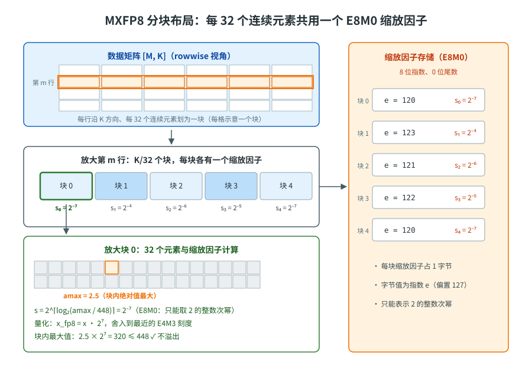
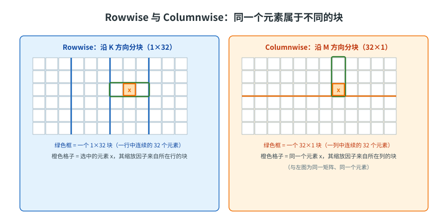

<!--
Copyright (c) 2022-2026, NVIDIA CORPORATION & AFFILIATES. All rights reserved.
Copyright (c) 2026, Huawei Technologies Co., Ltd. All rights reserved.
See LICENSE in the repository root for license information.
-->

# MXFP8

MXFP8 是 TENPU 提供的分块缩放策略：每 32 个连续数值共用一个 E8M0 缩放因子，相比张量级缩放（整个张量共用一个缩放因子）实现更细粒度的量化，提高数值精度。

## 数据格式

在 MXFP8 精度下，FP8 张量元素 `x` 的表示方式如下：

$$
x = x_{\mathrm{fp8}} \cdot s_{\mathrm{block}}
$$

其中：

- `x_fp8` 是 FP8 数值，格式由 `fp8_format` 参数决定；
- `s_block` 是由一个包含 32 个元素的块共同使用的局部 **E8M0** 缩放因子。E8M0 是一种 8-bit 格式，具有 8 位指数、0 位尾数，因此只能表示 2 的整数次幂。

**FP8 格式**

与 FP8 Blockwise Scaling 一样，MXFP8 默认在前向传播和反向传播中都使用 E4M3。更细粒度的缩放能够提供足够的动态范围，而不必使用 E5M2 格式。`fp8_format` 参数也支持 `HYBRID` 模式（前向使用 E4M3，反向使用 E5M2）。不支持仅使用 E5M2 的训练。

**块大小**

标准 `MXFP8BlockScaling` 的块大小为 32。每个块是一维的，包含 32 个连续数值，不进行二维缩放——激活、权重和梯度都遵循这一规则。

TENPU 另提供 `MXFP832x32BlockScaling` 变体：仅权重量化使用 32×32 二维块，且两个 GEMM 方向共享同一份 FP8 数据（各自配备独立的 scale 布局）；激活和梯度仍使用上述一维方向块。

对张量维度有以下要求：

- 张量至少具有 2 个维度。
- 最后一个维度必须能被 32 整除。
- 除最后一个维度之外，其他所有维度大小的乘积必须能被 32 整除。

**缩放因子**

缩放因子以 E8M0 格式存储（8 位指数、0 位尾数），因此天然表示 2 的整数次幂。这与 FP8 Blockwise Scaling 不同，FP8 Blockwise Scaling 使用 32-bit 浮点数存储缩放因子，并可选择将其限制为 2 的整数次幂。需要注意的是，FP32 同样具有 8 位指数，因此在启用 2 的整数次幂限制时，两者的可表示范围相同。

每个块的缩放因子按照以下步骤计算：

1. 在块内全部 32 个元素中，找到绝对值最大值 `amax_block`。

2. 计算 E8M0 的偏置指数：`e = float_to_e8m0(amax_block / max_fp8)`，其中 `max_fp8 = 448`，即 E4M3 格式所能表示的最大值。

   由于 E8M0 和 FP32 具有相同的指数偏置值 127，`float_to_e8m0` 只需从 FP32 表示中提取 8 位指数，并在尾数非零时向上取整。

3. 缩放因子为 `s_block = 2^(e - 127)`。

这可以确保每个块中的最大数值位于 FP8 可表示范围内，而不会溢出。在 TENPU 中，以上步骤由量化算子 `torch_npu.npu_dynamic_mx_quant` 在内部完成。

<p align="center"></p>

<p align="center">图 1：MXFP8 每 32 个连续元素共用一个 E8M0 缩放因子（每块 1 字节）。示例：块内 amax = 2.5 时 s = 2⁻⁷，块内最大值量化为 320 ≤ 448，不溢出。</p>

## 转置处理

### 昇腾 NPU 上的内存布局

与 tensorwise FP8 不同，MXFP8 为两个 GEMM 方向分别保存量化结果：rowwise 沿 K 按 1×32 分块，columnwise 沿 M 按 32×1 分块，每个块各有自己的 E8M0 缩放因子。分块方向不同，两种表示在数值上并不等价，不能通过转置其中一份来得到另一份，必须都从高精度输入分别量化。TENPU 的双轴量化算子 `npu_dynamic_mx_quant_with_dual_axis` 可以在一次调用中同时产生两种表示，两份输出的形状都与输入相同（`[M, K]`）。

GEMM 取数时，`MXFP8TensorStorage.get_data()` 按 usage 返回对应方向的数据；需要转置的 usage 由 `transpose_mx_data` 把数据和缩放因子一起转为转置视图。

**32×32 权重变体的区别**：使用 `MXFP832x32BlockScaling` 策略时，仅权重改用 32×32 二维块量化（`npu_dynamic_block_mx_quant`），两个 GEMM 方向**共享同一份 FP8 数据**，columnwise 数据即 rowwise 的转置视图，仅缩放因子布局各自独立——这与上文"两种表示必须分别量化"的结论不同。原因在于：一维方向块的缩放因子与块方向绑定，转置后块定义不再成立；而 32×32 块的缩放因子网格在转置下仍然自洽。激活和梯度仍走标准一维路径；仅需单方向时（如推理），权重量化器也会回到标准单轴路径。

<p align="center"></p>

<p align="center">图 2：橙色格子标出矩阵中的元素 x。它在 rowwise（1×32 块）与 columnwise（32×1 块）中属于不同的块、使用不同的缩放因子，因此两种表示必须分别量化。</p>

## 分布式训练

**缩放因子同步**

经过分块缩放的张量不需要在节点之间同步缩放因子。这是因为每个缩放因子只属于自身的 32 元素块；与之不同，[FP8 Current Scaling](FP8_Current_Scaling.md) 和 Delayed Scaling 会对整个张量使用单一的全局缩放因子，即使张量已经被分片也是如此。

**量化 All-gather**

TENPU 支持以 MXFP8 数据执行 All-gather：通信前先完成量化，可减少需要传输的数据量。设备要求与 MXFP8 训练相同。

## 示例

下面展示如何在 PyTorch 中使用 MXFP8 策略：

**PyTorch**

```python
import torch
import torch_npu
import transformer_engine.pytorch as te
from transformer_engine.pytorch.quantization import is_mxfp8_available
from transformer_engine.common.recipe import MXFP8BlockScaling, Format

torch.npu.set_device(0)
available, reason = is_mxfp8_available(return_reason=True)
if not available:
    raise RuntimeError(reason)

# 可选格式：
#   - Format.E4M3（默认）—— 前向和反向均使用 E4M3
#   - Format.HYBRID —— 前向 E4M3，反向 E5M2；不支持纯 E5M2
recipe = MXFP8BlockScaling()

# 参数以 BF16 保存的线性层
layer = te.Linear(1024, 1024, params_dtype=torch.bfloat16, device="npu")
inp = torch.randn(32, 128, 1024, dtype=torch.bfloat16, device="npu")

with te.autocast(enabled=True, recipe=recipe):
    output = layer(inp)
    loss = output.sum()

# 反向在量化上下文外执行
loss.backward()
```

## 量化器

**PyTorch**

MXFP8 使用 `MXFP8Quantizer`。每个包含 32 个元素的块共用一个 2 的整数次幂形式的 E8M0 缩放因子。该缩放因子根据量化时该块的 `amax` 计算，无需外部状态。

```python
import torch
import torch_npu
from transformer_engine.pytorch.tensor import MXFP8Quantizer

tensor = torch.randn(256, 256, device="npu", dtype=torch.bfloat16)

quantizer = MXFP8Quantizer(fp8_dtype=torch.float8_e4m3fn)

qtensor = quantizer(tensor)
roundtrip = qtensor.dequantize()
```
