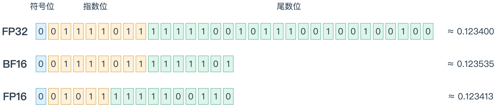
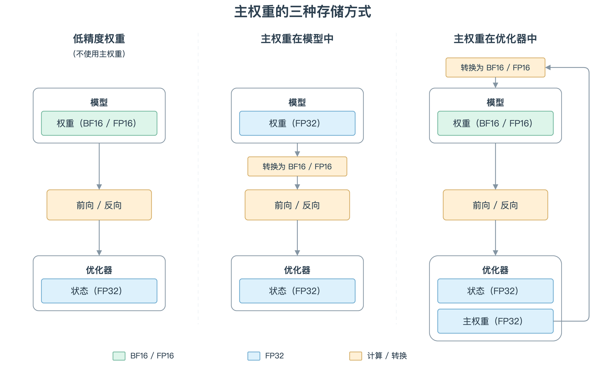
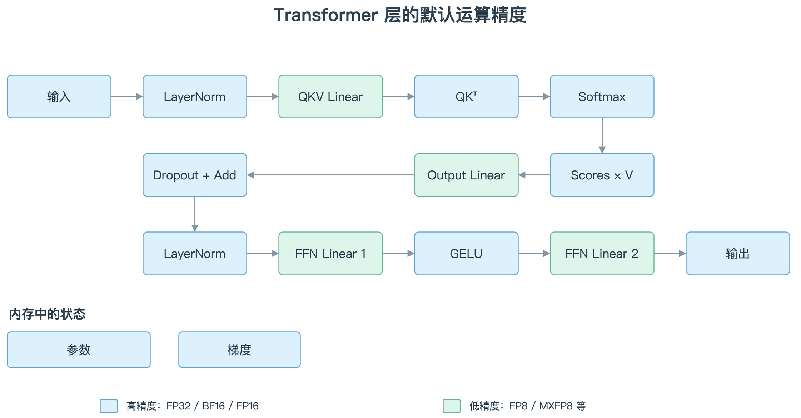
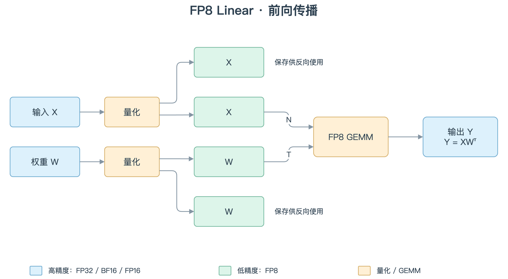
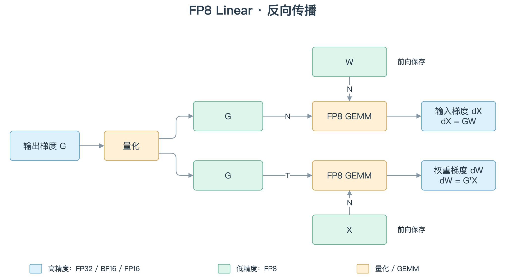

<!--
Copyright (c) 2022-2026, NVIDIA CORPORATION & AFFILIATES. All rights reserved.
Copyright (c) 2026, Huawei Technologies Co., Ltd. All rights reserved.
See LICENSE in the repository root for license information.
-->

# 低精度训练入门


TransformerEngineNPU（TENPU）通过低精度计算加速昇腾 NPU 上的模型训练。本章先介绍 BF16 / FP16 混合精度训练，再说明如何使用策略与量化上下文启用 FP8，以及 Linear 前向和反向中的数据流。


## BF16 与 FP16 训练

### 浮点格式

浮点数可以类比科学计数法来理解。例如，$+1.234 \times 10^{-1}$ 用正负号表示方向，用指数表示数量级，用有效数字描述具体数值。计算机中的二进制浮点数采用类似方式，只是以 $2$ 为底，并将信息存放在三个字段中：

- **符号位**：表示数值的正负，`0` 表示正，`1` 表示负。
- **指数位**：编码 $2$ 的幂次，决定数值的数量级。指数位越多，通常能覆盖越大的数值范围。
- **尾数位**：保存有效数字的一部分。对于正规数，二进制最高位的 `1` 隐含、不存储；尾数位越多，同一数量级内可表示的数值就越密集，舍入误差通常越小。

FP32、BF16 和 FP16 的区别在于总位数以及这些位如何分配。FP32 使用 32 位；BF16 和 FP16 都使用 16 位，但 BF16 为指数保留更多位，FP16 则为尾数保留更多位。下表列出各字段实际占用的存储位数：

| 格式 | 总位数 | 符号位 | 指数位 | 尾数位 | 特点 |
|---|---:|---:|---:|---:|---|
| FP32 | 32 | 1 | 8 | 23 | 标准单精度浮点格式 |
| BF16 | 16 | 1 | 8 | 7 | 保留 FP32 的指数范围，但有效精度更低 |
| FP16 | 16 | 1 | 5 | 10 | 动态范围较小，但在两者均为正规数的范围内，精度高于 BF16 |




对于图中这样的正规数，实际数值由三部分共同决定：

$$
x = (-1)^s \times \left(1 + \frac{F}{2^m}\right) \times 2^{E-\mathrm{bias}}.
$$

其中，$s$ 是符号位，$E$ 是将指数位当作无符号整数读取的结果，$F$ 是将尾数位当作无符号整数读取的结果，$m$ 是尾数位数。括号中的 $1$ 是正规数隐含的最高位，不占图中的存储位。FP32 和 BF16 的指数偏置 $\mathrm{bias}=127$，FP16 为 $15$。零、次正规数、无穷和 NaN 不使用这条正规数公式。

以图中的 BF16 为例，符号位为 `0`，指数位 `01111011` 对应 $E=123$，尾数位 `1111101` 对应 $F=125$。代入可得：

$$
x_{\mathrm{BF16}}
= (-1)^0 \times \left(1 + \frac{125}{128}\right) \times 2^{123-127}
= \frac{253}{2048}
= 0.12353515625.
$$

三行都以十进制数 `0.1234` 为转换目标，按就近舍入选择对应格式中可表示的数；它们的指数均为 $-4$，尾数精度不同，因此实际保存的数值不同：

| 格式 | 指数整数 $E$ | 尾数整数 $F$ | 代入公式 | 精确存储值 |
|---|---:|---:|---|---|
| FP32 | 123 | 8173860 | $(1+8173860/2^{23})\times 2^{-4}$ | 0.1234000027179718017578125 |
| BF16 | 123 | 125 | $(1+125/2^7)\times 2^{-4}$ | 0.12353515625 |
| FP16 | 11 | 998 | $(1+998/2^{10})\times 2^{-4}$ | 0.1234130859375 |

BF16 的优势在于它与 FP32 具有相同的指数范围，因此两种格式之间的转换更容易避免上溢和下溢问题。FP16 在表示较小数值时能提供比 BF16 更高的精度，但动态范围有限，因此训练时通常需要使用损失缩放（loss scaling）来应对上溢和下溢问题。更多细节可参阅[混合精度训练论文](https://arxiv.org/pdf/1710.03740)。

### 低精度与高精度运算的边界

为了保持训练精度，并非所有运算都适合使用较低精度。混合精度训练根据运算的数值特性，为不同运算选择不同精度：

- **矩阵乘法**：计算量大，在较低精度下仍能保持数值稳定，是低精度加速的主要对象。
- **LayerNorm 和 softmax 等运算**：输入和输出可以使用低精度，但内部计算或其中的权重可能使用高精度。
- **损失计算和指数运算等**：需要在整个计算过程中保持高精度。

### 主权重

混合精度训练还需要考虑模型权重的存储方式。FP16 和 BF16 等低精度格式能够表示的数值间隔较大，在梯度更新时可能出现问题：当一个很小的梯度更新量加到较大的权重上时，如果更新量低于该格式的精度阈值，结果可能舍入回原来的权重值。此外，某些梯度元素本身也可能小到无法用低精度表示，尤其是在数据并行训练中汇总多个 NPU 的梯度后。

解决办法是维护 FP32 主权重（master weights）。训练时，将权重转换为低精度用于前向和反向计算，而梯度更新则作用于 FP32 主权重。这样，即使很小的更新量也能随训练逐步积累。

软件实现中通常有两种主权重存放方式：

- **保存在优化器中**：模型保存低精度权重，优化器在维护动量等状态的同时，保存权重的 FP32 副本。每次更新时，优化器先更新 FP32 副本，再将结果转换为低精度并写回模型。

  这种方式便于将主权重与其他优化器状态一起分片，例如 ZeRO 优化器。由于精度转换只发生在优化器更新时，当优化器更新频率低于模型执行频率时，例如梯度累积或流水线并行训练，这种方式也更快。

- **保存在模型中**：模型直接以 FP32 保存权重，在前向和反向计算时按需转换为低精度。这种方式可以直接配合普通优化器使用，无需优化器提供专门支持。




## 更低精度的训练

TENPU 的主要功能之一，是支持比 BF16 / FP16 更低的精度，例如 FP8和MXFP8。这些精度的处理逻辑更复杂：它们需要缩放因子，才能表示张量中完整的数值范围。有时整个张量共用一个缩放因子，有时每个数据块各有一个缩放因子。数值格式与相应训练逻辑的组合称为**策略（recipe）**。

本节介绍不同策略共有的逻辑，各种策略的细节将在后续章节中分别说明。

### 策略与量化上下文

TENPU 的 PyTorch API 提供 `autocast` 上下文管理器来控制精度。它与 `torch.autocast` 类似，但专门用于低精度训练。最重要的参数是 `recipe`，接收继承自 `Recipe` 的对象。

前向计算需要放在 `autocast` 上下文中，`.backward()` 调用则放在上下文外；反向会继承对应前向的配置。

下面是昇腾 NPU 上的标准 FP8 示例。当前能力检查要求 Ascend 950 或更新的设备；运行前需配置驱动、CANN、PyTorch、TorchNPU 和 TENPU，并检查 FP8 支持情况：

```python
import torch
import torch_npu
import transformer_engine.pytorch as te
from transformer_engine.common.recipe import DelayedScaling, Format

torch.npu.set_device(0)
available, reason = te.is_fp8_available(return_reason=True)
if not available:
    raise RuntimeError(reason)

recipe = DelayedScaling()
layer = te.Linear(1024, 1024, params_dtype=torch.bfloat16, device="npu")
inp = torch.randn(32, 1024, dtype=torch.bfloat16, device="npu")

with te.autocast(enabled=True, recipe=recipe):
    output = layer(inp)

# 反向在量化上下文外执行
loss = output.float().square().mean()
loss.backward()
```

### 在同一模型中使用多个策略

**顺序上下文（Sequential contexts）**：为模型的不同部分使用不同策略。下面的示例沿用上例的导入与 `inp`，运行前需通过上例的 NPU FP8 能力检查。

```python
encoder_recipe = DelayedScaling(fp8_format=Format.E4M3)
decoder_recipe = DelayedScaling(fp8_format=Format.HYBRID)

encoder = te.Linear(1024, 1024, params_dtype=torch.bfloat16, device="npu")
decoder = te.Linear(1024, 1024, params_dtype=torch.bfloat16, device="npu")

with te.autocast(enabled=True, recipe=encoder_recipe):
    hidden = encoder(inp)

with te.autocast(enabled=True, recipe=decoder_recipe):
    output = decoder(hidden)
```

**嵌套上下文（Nested contexts）**：内层上下文在其作用域内覆盖外层配置，退出后恢复外层配置。下面的示例沿用上例的导入与 `inp`，运行前需通过 NPU FP8 能力检查。

```python
outer_recipe = DelayedScaling(fp8_format=Format.E4M3)
inner_recipe = DelayedScaling(fp8_format=Format.HYBRID)

layer1 = te.Linear(1024, 1024, params_dtype=torch.bfloat16, device="npu")
layer2 = te.Linear(1024, 1024, params_dtype=torch.bfloat16, device="npu")
layer3 = te.Linear(1024, 1024, params_dtype=torch.bfloat16, device="npu")

with te.autocast(enabled=True, recipe=outer_recipe):
    # layer1 uses outer_recipe
    x = layer1(inp)

    with te.autocast(enabled=True, recipe=inner_recipe):
        # layer2 uses inner_recipe (overrides outer)
        x = layer2(x)

    # layer3 uses outer_recipe again
    output = layer3(x)
```

### 使用 8 位或 4 位格式的混合精度训练

从这里开始，FP8、MXFP8、MXFP4 等称为“低精度”，FP32、BF16、FP16 称为“高精度”。后续文档沿用这一术语约定。

并非所有运算都使用低精度：

- **Linear 运算**：使用低精度。
- **Attention 运算**：默认使用高精度，部分策略允许选择低精度。
- **其他运算**：例如 LayerNorm、softmax，使用高精度。

高精度运算又分为两类：

- **精度可配置**：大部分运算使用参数精度（FP32 / BF16 / FP16），或 `torch.autocast` 指定的精度。
- **固定使用 FP32**：某些运算或运算中的部分步骤，例如 LayerNorm 中的除法，始终使用 FP32，不受其他精度设置影响。



### Linear 的前向与反向数据流

下面以单张昇腾 950 NPU 上使用 FP8 的 Linear 为例，说明前向与反向的数据流。为突出矩阵乘法，省略偏置项。

设输入为 `X`、权重为 `W`、输出梯度为 `G`，三个矩阵乘法分别是 `Y = XWᵀ`、`dX = GW` 和 `dW = GᵀX`。图中的转置表示数学运算关系；底层数据布局由量化器和 GEMM 实现处理，不表示必须额外保存一份转置副本。

**前向传播**：

1. 将输入量化为 FP8。
2. 将高精度权重量化为 FP8。
3. 使用量化后的输入和权重执行 FP8 GEMM，计算 `input × weightᵀ`。
4. 输出以高精度返回，并按反向计算需要保存输入和权重的量化表示。



**反向传播**：

1. 将输出梯度量化为 FP8。
2. 使用输出梯度和前向保存的权重执行 FP8 GEMM，计算输入梯度 `output_grad × weight`。
3. 使用输出梯度和前向保存的输入执行 FP8 GEMM，计算权重梯度 `output_gradᵀ × input`。
4. 输入梯度和权重梯度以高精度返回。


