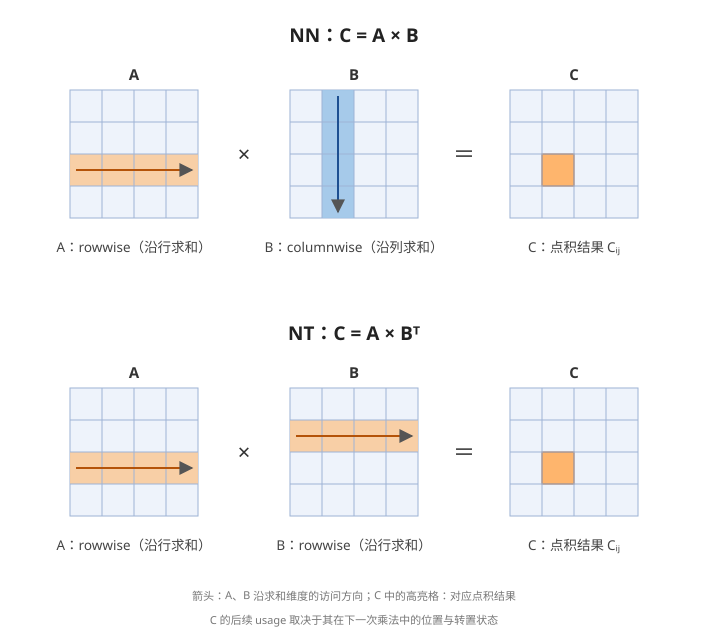
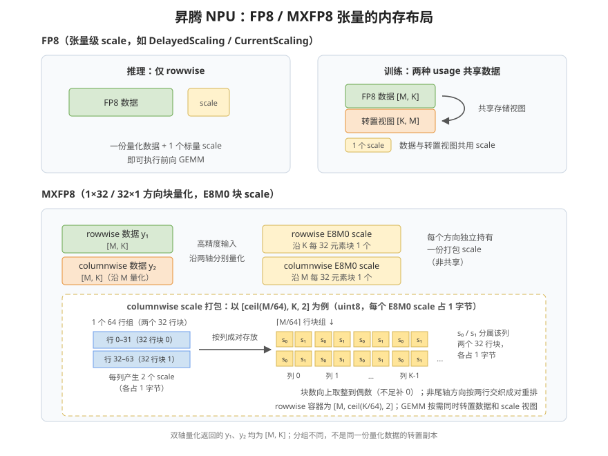
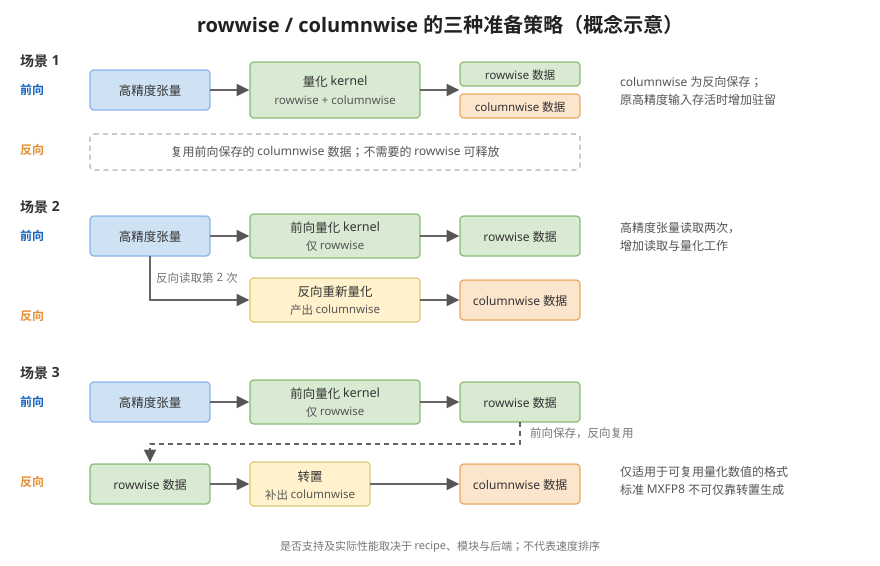
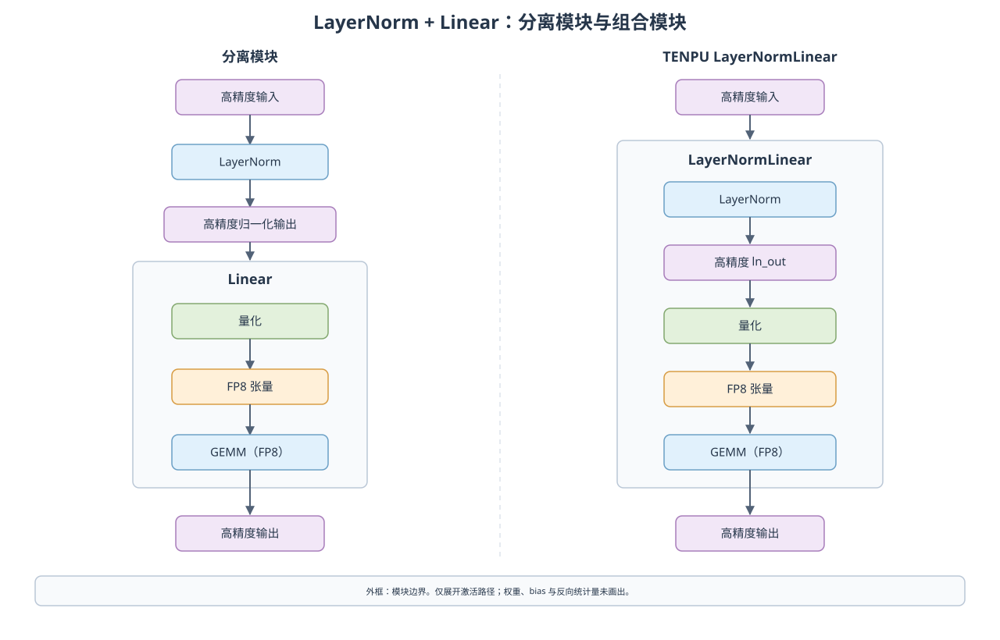
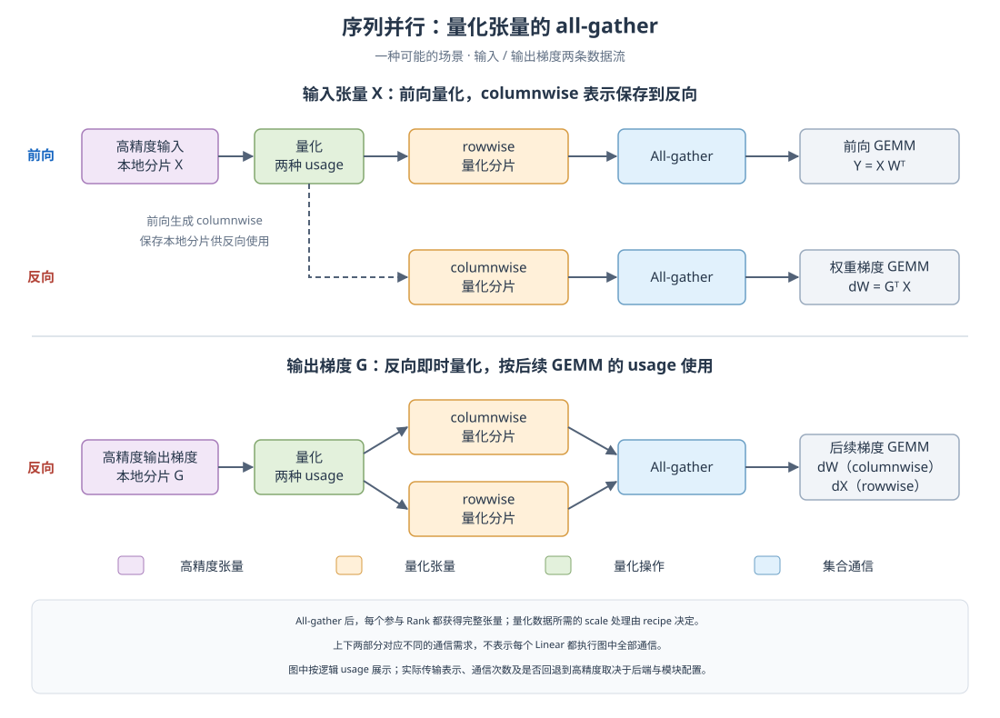

<!--
Copyright (c) 2026, Huawei Technologies Co., Ltd. All rights reserved.
See LICENSE in the repository root for license information.
-->

# 低精度训练的性能考量

低精度训练并不只是"把 GEMM 换成 FP8"这么简单。量化本身有开销，张量的内存布局会影响能否高效执行 GEMM，为反向传播保留哪些张量直接影响显存占用，而集合通信与量化之间的配合方式决定了并行扩展的效率。本章结合 TENPU 在昇腾 NPU 上的实现，介绍影响低精度训练性能的主要因素与调优建议。

## 处理转置

### 张量的两种使用方式

每个量化张量可能有两种使用方式（usage）：

- **rowwise usage**：沿逻辑矩阵的行方向使用元素；
- **columnwise usage**：沿逻辑矩阵的列方向使用元素。

这里的 usage 描述逻辑方向，不保证硬件逐元素的访问顺序，也不等同于物理内存布局。以矩阵 $A$ 和 $B$ 相乘为例分析求和维度：

- 对于 NN（均不转置）乘法 $C = AB$，计算公式为 $C_{ij} = \sum_k A_{ik} B_{kj}$。计算 $C_{ij}$ 时沿 $A$ 的第 $i$ 行（$A_{i0}, A_{i1}, \dots$）和 $B$ 的第 $j$ 列（$B_{0j}, B_{1j}, \dots$）遍历，因此 $A$ 按 rowwise 访问，$B$ 按 columnwise 访问。
- 对于 NT（第一个不转置、第二个转置）乘法 $C = AB^T$，公式变为 $C_{ij} = \sum_k A_{ik} B_{jk}$。此时沿 $A$ 的第 $i$ 行和 $B$ 的第 $j$ 行遍历，两个张量都按 rowwise 访问。

由此可以总结出一般规律：

- 乘法中的**第一个张量**在不转置时按 rowwise 访问，转置时按 columnwise 访问；
- **第二个张量**正好相反：不转置时按 columnwise 访问，转置时按 rowwise 访问；
- 结果矩阵 $C$ 中的高亮元素表示上述点积的结果。图中的箭头只表示操作数沿求和维度的访问方向，不表示 $C$ 的写入顺序；$C$ 作为后续乘法的操作数时，其 usage 仍由它的位置和转置状态决定。



不同转置状态下两个操作数的访问方式汇总如下：

**表 1：不同转置状态下两个操作数的访问方式**

| | 第一个张量 | 第二个张量 |
|---|---|---|
| 不转置 | rowwise | columnwise |
| 转置 | columnwise | rowwise |

### Linear 层的 GEMM 访问模式

下面将这些规则应用到 Linear 层。

当输入梯度和权重梯度都需要计算时，一个 Linear 层涉及三次 GEMM：前向一次，反向两次；不需要的梯度分支可以跳过。设输入为 `X`、权重为 `W`、输出梯度为 `G`：

**表 2：Linear 层三次 GEMM 中各张量的访问方式**

| GEMM | 公式 | 第一个张量 | 第二个张量 |
|---|---|---|---|
| 前向 | `Y = X * W^T` | input：rowwise | weight：rowwise |
| 权重梯度 | `dW = G^T * X` | output_grad：columnwise | input：columnwise |
| 输入梯度 | `dX = G * W` | output_grad：rowwise | weight：columnwise |

**前向 GEMM 的输入和权重都使用 rowwise 表示**。前向量化仍可能同时生成 columnwise 表示，供后续反向使用。

反向引入了 columnwise 访问：权重梯度的两个操作数都是 columnwise，输入梯度中输出梯度是 rowwise 而权重是 columnwise。因此在完整的前反向计算中，这三个张量都有两种逻辑用法；是否需要两份数据、何时生成以及保留多久，由 recipe 和具体计算分支决定。

### 昇腾 NPU 上的内存布局

BF16/FP16 张量可通过转置视图交给 GEMM；形状、连续性及对齐要求仍由所用算子决定。对于量化张量，需要区分以下两类：

- **张量级 FP8（`DelayedScaling` / `Float8CurrentScaling`）**：当前普通量化路径生成一份 `_data` 和一个 `scale_inv`。`Float8TensorStorage.get_data()` 根据 GEMM usage 返回 `_data` 或其 `.t()` 视图，二者共享底层存储；不能因为类中存在 `_transpose` 字段，就认定每个张量都常驻两份物理数据。底层算子的临时工作区不包含在这一存储描述中。
- **标准 `MXFP8BlockScaling`**：权重、激活及梯度均按量化方向每 **32 个元素**一组，每组使用一个 E8M0 scale（占 1 字节）。对逻辑形状 `[M, K]`，rowwise 沿 K 按 **1×32** 分组，columnwise 沿 M 按 **32×1** 分组。两个方向需要从高精度输入分别量化，不能只转置一份量化结果来得到另一方向。双轴量化算子可以一次产生两种表示；其 FP8 输出 `y1`、`y2` 的形状均与输入相同，即 `[M, K]`。转置视图由 GEMM 的 usage 决定，不能把 `y2` 直接画成 `y1` 的 `[K, M]` 副本。

MXFP8 的 scale 按 uint8 容器打包：末维的 2 表示两个 scale 字节，不是把一个 scale 压缩成半字节。rowwise 容器形状为 `[M, ceil(K/64), 2]`，columnwise 为 `[ceil(M/64), K, 2]`；GEMM 需要时还会对数据和 scale 做对应的视图变换。非尾轴的 scale 按两个行块交织存放：对于每列，连续的 `s₀`、`s₁` 分别属于前后两个 32 行块。块数不足偶数时补 0。打包布局不代表量化块为 32×32。这与 [Ascend 双轴量化算子的输出说明](https://github.com/Ascend/op-plugin/blob/0abe20992cf389c4e9615f96f7198205a155c769/docs/zh/custom_APIs/torch_npu/torch_npu-npu_dynamic_mx_quant_with_dual_axis.md)一致。

`MXFP832x32BlockScaling` 是另一种 recipe：其双方向权重量化路径使用 32×32 块并共享权重数据，激活和梯度仍使用方向块量化；仅需单方向时权重量化器回到标准单轴路径。下面的 MXFP8 图仅指标准 `MXFP8BlockScaling`。



在标准 MXFP8 Linear 训练路径中，输入的两种表示可以在前向量化时同时产生，但前向结束后会释放自有量化输入的 rowwise 数据，仅保留反向所需的 columnwise 数据。权重可能保留两种表示；推理时只请求 rowwise。故“训练总是为每个张量保留两份数据”并不准确。

### 量化融合

表示准备有三种典型策略。下图用于解释这些策略，不表示 TENPU 对所有 recipe 都实现了三条路径，也不代表性能排序。

1. **前向同时生成两个方向的量化表示**：TENPU 标准 MXFP8 在两种 usage 都需要时调用 `npu_dynamic_mx_quant_with_dual_axis`。前向后可释放不再需要的表示；若高精度输入另有持有者，量化数据会增加额外驻留。
2. **前向生成 rowwise，保存高精度输入，反向重新量化**：例如支持 `save_original_input=True` 的路径。能否与其他操作融合取决于具体算子；重新读取输入和量化会产生额外工作。
3. **保存 rowwise，在反向转换布局**：仅适用于量化数值可复用、只是布局不同的格式。标准 MXFP8 的两个方向采用不同分组，不能使用简单转置替代重新量化；TENPU 普通张量级 FP8 则通常直接复用同一份数据的视图，无需额外物理副本。



实际路径由模块的 usage 请求、recipe、`save_original_input`、反向精度覆盖及并行配置共同决定。融合能否降低耗时，需要在相同形状、精度策略和设备上测量。

### 量化器 API 中的 usage

量化器的 `rowwise` / `columnwise` 标志（对应 `rowwise_usage` / `columnwise_usage` 属性）决定 `quantize()` 产出哪些表示。两者同时启用时由单个融合 kernel 一次产出，即上文第 1 种策略；仅启用一个方向时走对应方向的单轴量化路径。

```python
import torch
import torch_npu
from transformer_engine.pytorch.tensor.mxfp8_tensor import MXFP8Quantizer

quantizer = MXFP8Quantizer(
    fp8_dtype=torch.float8_e4m3fn,
    rowwise=True,
    columnwise=True,
)

x = torch.randn(1024, 1024, dtype=torch.bfloat16, device="npu")
qtensor = quantizer(x)  # 双表示，单次融合 kernel

# 前向使用后释放 rowwise 数据，仅保留 columnwise 供反向权重梯度使用
qtensor.update_usage(rowwise_usage=False)
```

量化后，量化张量的 `update_usage(rowwise_usage=..., columnwise_usage=...)` 只能删减表示：传 `False` 释放对应数据，留作 `None`（默认）保持现状。它不支持补生成缺失的表示——请求一个当前不存在的表示会直接报错。原因与上文策略 3 的限制一致：标准 MXFP8 两个方向的分组与 scale 不同，无法由一份量化数据转换得到另一方向；张量级 FP8 两个方向共享同一份数据，释放后同样无法从转置恢复。因此缺失的表示需要重新量化获得，或在首次量化时以双 usage 一次产出。

## 内存占用

低精度计算不保证比 BF16 训练更省显存。量化副本、scale、被保存的激活、梯度、优化器状态和算子临时工作区都可能影响结果。

### 模型权重与主权重

默认模型参数以指定的高精度 dtype 保存。低精度前向会在需要时量化权重；反向可以复用已保存的量化权重，启用 `is_first_microbatch` 等缓存路径后也可以跨微批次复用，不能概括为“每次 GEMM 前都重新量化”。权重更新后，缓存必须由调用方按接口约定刷新。

`quantized_model_init` 可让模型权重直接以量化表示保存。若训练优化器需要 FP32 主权重，应由优化器或训练框架维护；TENPU 的初始化上下文本身不保证自动创建这份优化器状态。推理没有优化器更新，不需要为此保存 FP32 主权重。优化器分片、参数梯度和量化缓存应分别记账。

### 测量口径

- `memory_allocated()` 是当前由分配器计入的存活张量内存；`max_memory_allocated()` 是重置后记录的峰值，包含期间的临时分配。
- `memory_reserved()` 反映分配器保留的内存池，与存活张量内存不同。`empty_cache()` 不释放仍被引用的张量。
- 下文数值单位为 MiB，1 MiB = 1024 × 1024 字节。测量前同步设备、清理引用并记录基线，在明确的前向或反向边界同步后读数；前向结束占用和整段峰值不能混为一谈。
- `del inp` 只删除当前 Python 引用。autograd、模块缓存或其他变量仍可能持有其存储。共享视图和重复保存的 storage 不能重复计数。

### 实测示例

以下示例展示不同配置下 1024×1024 Linear 前向后的显存占用，参考数值来自既有 NPU 实机测试；实际数值因设备与软件版本而异，以实测为准。

**1. 基线：高精度前向**

```python
import torch
import torch_npu
import transformer_engine.pytorch as te


def measure_memory():
    torch.npu.empty_cache()
    torch.npu.reset_peak_memory_stats()

    init_memory = torch.npu.memory_allocated()
    layer = te.Linear(1024, 1024, params_dtype=torch.bfloat16, device="npu")

    inp = torch.randn(1024, 1024, dtype=torch.bfloat16, device="npu")
    out = layer(inp)
    del inp  # 输入由模型为反向保存，而非用户脚本

    mem_after_forward = torch.npu.memory_allocated() - init_memory
    return mem_after_forward


# 预热
measure_memory()

# 实际测量
mem_after_forward = measure_memory()
print(f"前向传播后内存占用: {mem_after_forward/1024**2:.2f} MB")
```

```text
前向传播后内存占用: 6.00 MB
```

层大小为 `1024 * 1024 * 2（每参数 2 字节）= 2 MB`。前向后的占用为 `2 MB（权重）+ 2 MB（为反向保存的输入）+ 2 MB（输出）= 6 MB`。

**2. FP8 训练，模型权重为 BF16**

```python
import torch
import torch_npu
import transformer_engine.pytorch as te
from transformer_engine.common.recipe import DelayedScaling

recipe = DelayedScaling()


def measure_memory():
    torch.npu.empty_cache()
    torch.npu.reset_peak_memory_stats()

    init_memory = torch.npu.memory_allocated()
    layer = te.Linear(1024, 1024, params_dtype=torch.bfloat16, device="npu")

    inp = torch.randn(1024, 1024, dtype=torch.bfloat16, device="npu")
    with te.autocast(enabled=True, recipe=recipe):
        out = layer(inp)
    del inp  # 输入由模型为反向保存，而非用户脚本

    mem_after_forward = torch.npu.memory_allocated() - init_memory
    return mem_after_forward


# 预热
measure_memory()

# 实际测量
mem_after_forward = measure_memory()
print(f"前向传播后内存占用: {mem_after_forward/1024**2:.2f} MB")
```

```text
前向传播后内存占用: 6.01 MB
```

总占用约为 `2 MB（BF16 权重）+ 1 MB（量化权重）+ 1 MB（为反向保存的量化输入）+ 2 MB（输出）= 6 MB`（另有少量 amax/scale 状态）。张量级配方的 columnwise 权重是同一份量化数据的转置视图，不额外占用显存。可见在此配置下 FP8 训练并不比 BF16 基线更省显存，收益主要来自计算加速，而非显存节省。

**3. FP8 推理，权重直接以低精度保存**

推理场景下权重可以直接以低精度保存。由于只执行前向、没有梯度更新，无需高精度主权重：

```python
import torch
import torch_npu
import transformer_engine.pytorch as te


def measure_memory():
    torch.npu.empty_cache()
    torch.npu.reset_peak_memory_stats()

    init_memory = torch.npu.memory_allocated()

    # FP8 推理，FP8 权重
    with te.quantized_model_init(enabled=True), torch.no_grad():
        layer_fp8 = te.Linear(1024, 1024, params_dtype=torch.bfloat16, device="npu")

    with torch.no_grad():
        inp = torch.randn(1024, 1024, dtype=torch.bfloat16, device="npu")
        with te.autocast(enabled=True):
            out = layer_fp8(inp)
        del inp  # 推理无需为反向保存输入

    mem_after_forward = torch.npu.memory_allocated() - init_memory
    return mem_after_forward


# 预热
measure_memory()

# 实际测量
mem_after_forward = measure_memory()
print(f"前向传播后内存占用: {mem_after_forward/1024**2:.2f} MB")
```

```text
前向传播后内存占用: 3.02 MB
```

总占用约为 `1 MB（FP8 权重）+ 2 MB（输出）= 3 MB`，低于 BF16 基线的 6 MB，因为推理模式不保存任何用于反向的副本。

**4. 保存原始输入而非量化副本**

默认情况下，TENPU 为反向保存 columnwise 量化的输入（权重梯度计算需要）。`save_original_input=True` 告诉层引用原始高精度输入，而不缓存量化副本，反向需要时再重新量化。以残差连接为例：

```python
import torch
import torch_npu
import transformer_engine.pytorch as te
from transformer_engine.common.recipe import Float8CurrentScaling

recipe = Float8CurrentScaling()


def residual_block(layer, inp):
    """残差连接：输入需保留用于线性层输出相加。"""
    out = layer(inp)
    return out + inp


def measure_memory(use_save_original):
    torch.npu.empty_cache()
    torch.npu.reset_peak_memory_stats()
    baseline = torch.npu.memory_allocated()

    layer = te.Linear(
        1024, 1024, params_dtype=torch.bfloat16,
        device="npu", save_original_input=use_save_original,
    )
    inp = torch.randn(
        1024, 1024, dtype=torch.bfloat16, device="npu", requires_grad=True,
    )

    with te.autocast(enabled=True, recipe=recipe):
        out = residual_block(layer, inp)
    out.sum().backward()

    return (torch.npu.max_memory_allocated() - baseline) / 1024**2


# 预热
measure_memory(False)
measure_memory(True)

# 实际测量
for use_save_original in [False, True]:
    peak = measure_memory(use_save_original)
    print(f"save_original_input={use_save_original}: {peak:.1f} MB")
```

```text
save_original_input=False: 29.0 MB
save_original_input=True: 29.0 MB
```

实测（峰值相对段起点的增量口径）显示，残差连接场景下两种配置的峰值增量完全相同。进一步在裸层负载（无残差连接、单次前向加反向）下实测，两种配置的步末常驻与步内峰值也完全一致（6.01 MB / 27.01 MB），即 `save_original_input` 开关在当前实现下不改变显存占用。

需要注意口径差异：本例的 29.0 MB 是"残差连接 + 输入需要梯度"负载下的峰值增量（`max_memory_allocated()` 减去段起点），不是绝对峰值；不同负载与口径下的数值不能直接并列比较。

注意事项：

- `save_original_input` 不支持 DelayedScaling recipe（`Float8Quantizer`）。在该 recipe 下启用会收到警告并自动禁用。
- 层级配置会被反向覆盖语义（backward override）调整：`high_precision` 覆盖强制保存原始输入，`dequantized` 覆盖则不保存。

## 融合层

TENPU 提供 `LayerNormLinear`、`LayerNormMLP` 等组合模块。**模块组合不等于 kernel 融合**：kernel 融合指把归一化与量化放进同一 kernel 执行，当前 TENPU 并未按此实现。

下图左侧展示分离模块的数据流；右侧展示 TENPU LayerNormLinear 的前向主路径。只画激活数据流，权重、bias 和为反向保存的统计量未展开。



kernel 融合路径把归一化与量化放在同一 kernel 内，后续再执行 GEMM。TENPU 当前 `_layernorm_linear_forward_impl` 则先调用 `torch.native_layer_norm`（或 RMSNorm 算子）得到高精度 `ln_out`，随后调用输入量化器再执行 GEMM；BF16 LayerNorm 路径还会先转为 FP32 计算，再将结果转回输入 dtype。因此不能宣称 TENPU 当前已省去独立量化或高精度中间结果的分配，也不能在没有基准测试时保证组合模块更快或更省显存。

以下示例使用相同 dtype 和 recipe，并复制参数以保持两种写法的模型参数一致；它展示接口用法，不是性能测试。输出误差应按所用 recipe 和设备另行检查。

```python
import torch
import torch_npu
import transformer_engine.pytorch as te
from transformer_engine.common.recipe import MXFP8BlockScaling

layer_norm = te.LayerNorm(1024, params_dtype=torch.bfloat16, device="npu")
linear = te.Linear(1024, 1024, params_dtype=torch.bfloat16, device="npu")
fused = te.LayerNormLinear(1024, 1024, params_dtype=torch.bfloat16, device="npu")
with torch.no_grad():
    fused.layer_norm_weight.copy_(layer_norm.weight)
    fused.layer_norm_bias.copy_(layer_norm.bias)
    fused.weight.copy_(linear.weight)
    fused.bias.copy_(linear.bias)

inp = torch.randn(32, 128, 1024, dtype=torch.bfloat16, device="npu")
recipe = MXFP8BlockScaling()
with te.autocast(enabled=True, recipe=recipe):
    separate_output = linear(layer_norm(inp))
    fused_output = fused(inp)
```

## 分布式训练

TENPU 模块根据进程组、并行模式及 sequence parallel / overlap 配置调用集合通信；调用方仍需正确初始化分布式环境，并选择后端支持的配置。

回顾 Linear 层涉及的六个张量：权重、输入、输出及其梯度。在常规高精度输出配置下，输出和返回梯度使用激活 dtype；另有量化输出等路径，不能一概而论。本节只讨论张量/序列并行中的 **输入**和**输出梯度** all-gather，不讨论数据并行梯度同步或 FSDP 参数通信。

对于序列并行（sequence parallelism），在 recipe 与通信路径支持时，可以先在各 Rank 上量化本地分片，再对量化张量做 all-gather。其潜在收益包括：

1. **减少显存占用**——为反向保存量化分片；若其他算子不需要原始高精度张量，可释放对应的高精度副本；
2. **减少通信量**——传输量化数据，并按 recipe 处理所需的 scale；
3. **并行化量化**——各 NPU 分别量化自己的本地分片。

下图分别展示输入与输出梯度的通信需求：

- **输入 X**：前向量化产生 rowwise 与 columnwise 表示。rowwise 分片经 all-gather 参与前向 GEMM；columnwise 分片保存到反向，再经 all-gather 参与权重梯度计算。
- **输出梯度 G**：在反向即时量化，产生 columnwise 与 rowwise 表示；经 all-gather 后，分别用于权重梯度与输入梯度计算。图中合并展示集合通信步骤，不限定底层通信次数或物理传输布局。



这是**一种可能的场景**，上下两部分不表示每个 Linear 都执行全部通信。All-gather 会使每个参与 Rank 获得完整张量，而非只汇总到单个 Rank；保存什么表示、是否重新量化以及通信与 GEMM 是否融合，取决于 recipe、并行方式与模块配置。

TENPU 中，普通 `gather_along_dim` 与 MC2 通算融合是不同路径。例如当前普通 MXFP8 gather 会回退到高精度 all-gather 后重新量化；通算融合路径则可调用 `npu_all_gather_quant_mm`。因此不能将图中的“先量化、后通信”视为所有 FP8 / MXFP8 配置都支持的固定流程。

### 通算融合（MC2）

TENPU 的 overlap 路径可调用 `npu_all_gather_quant_mm`、`npu_quant_mm_reduce_scatter` 等接口，将通信与矩阵计算交由通算融合算子执行。是否隐藏通信耗时取决于设备、张量形状、通信组及算子支持；不能只凭启用配置就推断实际加速比例。

## 与训练框架的配合

MindSpeed / Megatron-LM 侧的模块选择、量化权重复用、优化器主权重、梯度缓冲和重计算策略会共同影响内存占用。配置前应核对所用框架版本的文档与实际 TENPU 调用路径，尤其是 recipe、`is_first_microbatch`、sequence parallel 和通信 overlap 的组合限制。本章不将未经版本核对的外部启动参数或兼容性组合列为通用保证。

## 依据与相关文档

本文的 TENPU 实现说明以 PR #239 所基于的代码为准。主要核对入口：

- [Linear 前反向与输入保存](../../../../transformer_engine/pytorch/module/linear.py)、[量化权重缓存与参数初始化](../../../../transformer_engine/pytorch/module/base.py)。
- [张量级 FP8 量化](../../../../transformer_engine/pytorch/tensor/float8_tensor.py)、[FP8 存储和转置视图](../../../../transformer_engine/pytorch/tensor/storage/float8_tensor_storage.py)。
- [MXFP8 量化](../../../../transformer_engine/pytorch/tensor/mxfp8_tensor.py)、[MXFP8 usage 释放](../../../../transformer_engine/pytorch/tensor/storage/mxfp8_tensor_storage.py)、[默认 recipe](../../../../transformer_engine/pytorch/quantization/utils.py)。
- [LayerNormLinear 前向](../../../../transformer_engine/pytorch/module/layernorm_linear.py)、[普通 all-gather 与回退](../../../../transformer_engine/pytorch/distributed.py)。
- [低精度训练入门](introduction.md)：混合精度训练基础。
