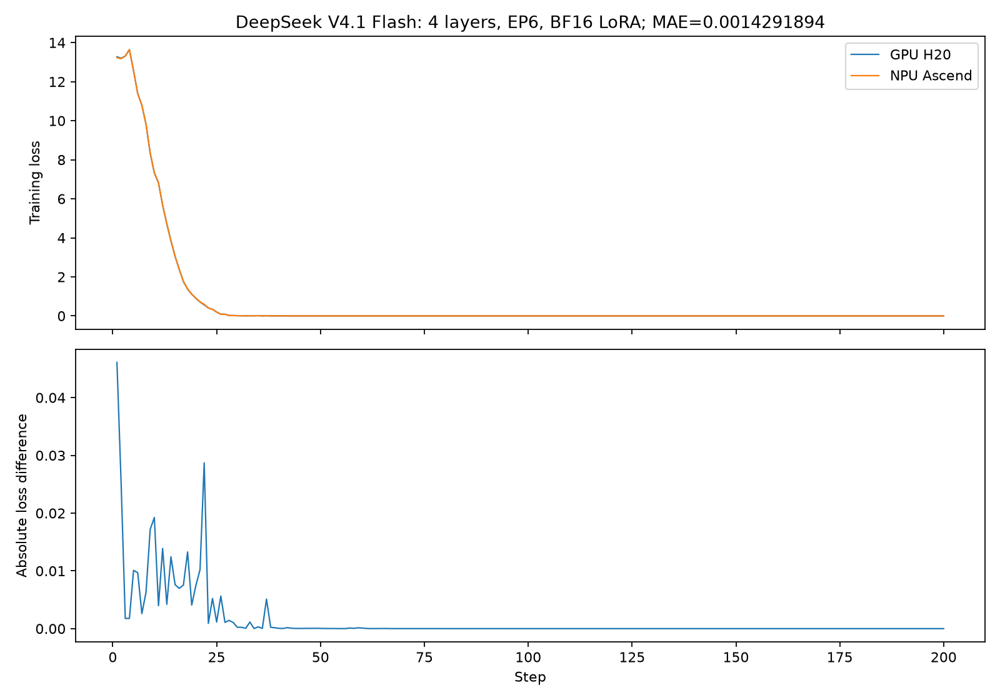

# DeepSeek V4.1 Flash：NPU 软件环境、兼容补丁与 GPU 减层精度验证

记录日期：2026-10-29。交付仓库：[addsubmuldiv/swift_dsv41_npu](https://github.com/addsubmuldiv/swift_dsv41_npu)。
本文对应仓库内的固定源码快照；不把“Core 0.19”或“TENPU 2.17.1”这个版本号单独当作兼容性保证。

## 1. 已验证到什么程度

当前已经完成：

1. 将五份固定版本源码放进一个普通 Git 仓库，预先应用 py311 补丁；不使用 submodule。
2. 在独立 Python 3.11 环境运行一键安装，检查依赖、源码实际加载位置、NPU 张量运算和模型初始化。
3. 普通克隆到另一个目录后再次安装成功，没有依赖原机器上的旧源码路径。
4. 四层 DeepSeek V4.1 Flash 在单机 6 张 NPU 上完成 5 步 LoRA，保存 Megatron checkpoint 和 safetensors。
5. 在 Python 3.12 下完成 GPU/NPU 各 200 步的减层 loss 对比；修复专家 LoRA 并行标记问题后，MAE 为 **0.00142918945**。
6. 将 checkpoint 反量化搬到 NPU 后，重新运行 NPU 200 步，与原 NPU 路径的 200 个已报告 loss 全部相同；对已有 GPU 基线的 MAE 不变。

**尚不能宣称 GPU/NPU 完全对齐。** 本次也没有验证完整模型训练、多机训练或 Python 3.11 的 GPU/NPU 200 步对比。

## 2. 软件版本与源码来源

### 2.1 NPU 已验证环境

| 组件 | 已验证版本/配置 | 说明 |
| --- | --- | --- |
| 系统/CPU 架构 | openEuler 22.03 LTS-SP4，Linux x86_64 | 未验证 aarch64 的 wheel 和运行链路 |
| NPU | Ascend910_9382，64 GiB/卡 | 减层实验使用 6 卡 |
| 驱动/管理工具 | 本机 `npu-smi` 报告 26.1.1 | 复用已有驱动 |
| CANN | 9.2.0 | 复用系统安装，未自动升级/降级 |
| Python | 3.11.18 | 当前集成仓库的安装及 5 步训练验证 |
| Python | 3.12.16 | GPU/NPU 正式 200 步比较使用的版本 |
| PyTorch | 2.10.0+cpu | NPU wheel 的基础 Torch 构建；通过 torch_npu 执行 NPU 运算 |
| TorchNPU | 2.10.0.post7 | 必须使用与 Python ABI 对应的 wheel |
| Transformers | 5.12.1 | 保持与模型及精度实验一致 |
| TENPU | 2.17.1 | 使用下表固定提交，而非任意同版本源码 |
| Triton / Triton-Ascend | 3.6.0 / 3.6.0 | py311 JIT kernel 已实际编译执行 |
| NumPy / PEFT | 1.26.4 / 0.20.0 | 与对比实验一致 |
| torchvision / torchaudio | 0.25.0+cpu / 2.10.0+cpu | 测试基础环境中的配套版本 |
| av / networkx | 18.1.0 / 3.6.1 | 为 py311 选择的兼容版本 |

原始相关 PR 曾使用 CANN 9.1；本机实际是 9.2。这里报告的是 9.2 上的实测结果，
不替代厂商的完整兼容矩阵，也不意味着任意 CANN/驱动组合都可互换。

### 2.2 五个源码组件

| 目录 | 来源 | 固定提交 |
| --- | --- | --- |
| `ms-swift/` | addsubmuldiv/ms-swift | `a013ae639060ba3439a60dd7cb07ff9561d06be6` |
| `mcore-bridge/` | addsubmuldiv/mcore-bridge | `e7cb294a24cf98ac16be85774646cc8f46f9f6c2` |
| `Megatron-LM/` | NVIDIA/Megatron-LM 的 DeepSeek 专用实现 | `5c6efbc278b708c046e5b558964cb021f6fd750b` |
| `MegatronAdaptor/` | Ascend/MegatronAdaptor | `c7e52b2c8482105e6ec7fcd8cdef364e7c7b22c5` |
| `TransformerEngineNPU/` | Ascend/TransformerEngineNPU | `93eca54f264510f31dd10b68cd8ae18ad9a96bbe` |

MCore 基础版本显示为 0.19.0，但本模型依赖这个特定提交中的 Hybrid/DeepSeek/Engram 接口，
不能用普通 `core_r0.19.x` 或 pip 发布版本直接替代。确切来源见 [sources.lock.json](../sources.lock.json)。
MCore 和 TENPU 的 py311 改动已叠加在上述提交上；其余 bridge 兼容改动已包含在 `e7cb294` 中。

`MegatronAdaptor` 必须先于 MCore/Swift 初始化导入。TENPU 与 NVIDIA TransformerEngine 都使用
`transformer_engine` 模块名；NPU 环境使用 TENPU，GPU 环境使用 NVIDIA 实现，不应混装。
本环境没有额外安装 MindSpeed、FLA 或 vLLM；纯 SFT 不使用 rollout 后端。

注意：Adaptor 会将 `importlib.metadata.version('transformer-engine')` 的兼容性返回值包装为 `2.2.0`。
这不是实际安装版本降级。检查实际发行版可用：

```bash
python -m pip show transformer-engine
python -c "import importlib.metadata as m; print(m.distribution('transformer-engine').version)"
```

## 3. 环境如何配置

### 3.1 基础镜像

目标容器应已有 Python 3.11、Torch/TorchNPU 2.10、可访问的 NPU 设备以及 CANN/驱动。
一键脚本使用当前 Python，不创建 Conda、不安装系统驱动、不替换已有 Torch/TorchNPU。
基础版本不符合要求或设备不可用时会报错。

如果是自行准备全新的基础环境，已验证的 x86_64 wheel 组合是：

```bash
python -m pip install --index-url https://download.pytorch.org/whl/cpu \
  'torch==2.10.0+cpu' 'torchvision==0.25.0+cpu' 'torchaudio==2.10.0+cpu'
python -m pip install \
  --index-url https://repo.huaweicloud.com/repository/pypi/simple \
  --extra-index-url https://mirrors.huaweicloud.com/ascend/repos/pypi \
  'torch-npu==2.10.0.post7'
```

已有匹配基础镜像时无需重复执行这两条。Python 3.11 需要 cp311 wheel，不能复制 cp312 的
`site-packages` 或二进制扩展来代替安装。

### 3.2 一键安装

```bash
git clone https://github.com/addsubmuldiv/swift_dsv41_npu.git
cd swift_dsv41_npu
bash setup_deepseek_v41_npu.sh
source env.sh
```

安装脚本会：

- 约束当前基础 Torch/TorchNPU 版本，安装锁定的 Python 依赖。
- 用 `pip install --no-build-isolation -e .` 安装五个本地源码目录。
- 检查依赖、五个模块的实际加载路径、NPU 矩阵运算以及 DeepSeek V4.1 注册/初始化。
- 对内部标签不兼容的可选 decord 旧 wheel 做移除处理；不验证视频输入能力。

源码已经固定并打好补丁，脚本不再 fetch、checkout 或现场 patch。
默认 PyPI 镜像可通过 `PIP_INDEX_URL` / `PIP_EXTRA_INDEX_URL` 覆盖。

`env.sh` 根据自己的位置设置 `MEGATRON_LM_PATH`、源码搜索路径和 `NO_VCS_VERSION=1`，
避免 MCore 把外层集成仓库的提交号误当作自身版本后缀。它会尝试常见 CANN 环境脚本路径，
默认 Triton/扩展编译缓存放在节点本地 `/tmp`；每个新训练终端都应 `source env.sh`。

四台机器使用同一份共享源码时，只需克隆一次，然后在各自容器/各自 Python 环境运行安装脚本。
文件锁串行保护共享源码的 editable 元数据写入。各节点仍应使用一致的基础镜像和驱动栈。
**安装完成不等于已经执行了四机训练**；正式多机任务还需配置节点数、rank、master 地址、设备和数据。

## 4. 训练验证脚本与实际特性

```bash
source env.sh
MODEL_DIR=/path/to/DeepSeek-V4.1-Flash-1017 \
ASCEND_RT_VISIBLE_DEVICES=0,1,2,3,4,5 \
bash examples/smoke_train.sh
```

入口为 [smoke_train.sh](../examples/smoke_train.sh)，参数为 [smoke_config.json](../examples/smoke_config.json)，
实际训练使用 [train_smoke.py](../examples/train_smoke.py) 中的 typed Swift 参数，避免旧实验中出现过的
CLI `Optional[List[...]]` 解析差异；这不是对模型训练计算的修改。

准备脚本从本地权重生成减层配置、权重索引与 Engram tokenizer map，用软链接复用原始权重分片，
不下载或复制完整权重。它读取权重目录内官方的 tokenizer normalization/hash 辅助函数，
因此只应对可信的本地权重运行。生成内容和训练结果保存在 `.local/`，不进入 Git。

| 项目 | 实际配置 |
| --- | --- |
| 层/宽度 | 原始第 0–3 层，宽度 5120；未缩宽、未减专家 |
| 专家 | 384，router top-k 6，router FP32 |
| Engram/mHC | 保留首个 Engram；mHC 开启，4 residual streams，single-pass |
| Hybrid 表示 | HF 的 4 层在当前 Core 中是 `DEDEDEDE` 共 8 个 block，所以日志 `num_layers=8` |
| 并行 | 6 卡，EP6、TP1、PP1、CP1，sequence parallel 关闭 |
| 精度/LoRA | BF16，all-linear，rank 8，alpha 16，dropout 0，不 merge |
| 优化器/显存 | 分布式 Adam；整层重计算 `full + uniform`，每段 1 层；无 CPU offload、无 Megatron FSDP |
| MoE | grouped GEMM 开启；All-to-All 分发；permute/router fusion 和 shared-expert overlap 关闭 |
| Attention | `unfused`；DSA 专用 kernel backend 为 `none`，模型的 DSA/压缩注意力结构仍保留 |
| 其它融合 | 梯度累积、cross-entropy、masked-softmax、RoPE、fused mHC 关闭 |
| 默认融合标志 | `bias_activation_fusion=True`、`bias_dropout_fusion=True`，并非所有融合标志都关；dropout 数值为 0 |
| 其它开关 | packing、padding-free、Torch Compile、CUDA Graph、视觉、DSpark/MTP 关闭；未强制 NPU deterministic 模式 |
| Batch/数据 | micro batch 1，global batch 6；32 条合成数据，由两种问答重复组成；max length 128 |
| Shuffle | `dataset_shuffle=false`，但 `train_dataloader_shuffle=true` 为实际默认值，seed/data_seed 均为 42 |
| 学习率 | Adam β=(0.9,0.95)，eps=1e-8，weight decay=0.1，clip grad=1；lr=1e-4，cosine，无 warmup |
| 当前冒烟步数/保存 | 5 步，第 5 步保存 Megatron/safetensors；不保存 optimizer/RNG；lr_decay_iters=200 |

关闭这些高级融合并不代表完全不用 NPU 原生算子或 TENPU；线性、归一化等仍由配套实现执行。

FP4/FP8 是 checkpoint 的存储格式；这次训练参数使用 BF16，`fp8=None`、`fp4=None`、`fp8_param=False`，
没有启用 FP4/FP8 训练。原始切片保持模型的主要结构，但不代表完整深度模型的行为。

## 5. 遇到的问题、原因与补丁

### 5.1 版本与模型接口

普通 Core 0.19 的接口不足以覆盖这份 DeepSeek V4.1 checkpoint。
处理方式是固定含 Hybrid/Engram/DeepSeek 接口的 MCore 提交，并配套固定 Adaptor/TENPU，
不是只修改 `num_layers` 或升级一个 pip 版本号。

### 5.2 Engram 与 checkpoint 加载兼容

以下改动都已包含在 bridge 提交 `e7cb294`，无需再手工重复应用：

| 实际问题 | 当前处理 | 文件 |
| --- | --- | --- |
| 部分 native Engram 快照缺少 `slice_hashes_for_sequence_parallel`；直接导入会使 native Engram 检测失效 | 可选导入；旧实现 fallback 只允许 TP1 且无 SP，超出范围明确报错 | `model/modules/engram.py` |
| EngramConfig 的 `hash_layer_ids`、parallelism 检查签名、`tp_group` 和 forward 参数随快照变化 | 适配 hash/placement 层号、可选 sequence_length、TP group、packed_seq_params 和 add_residual | 同上 |
| 当前原生 HybridStack 已在 mHC 前注入 Engram，旧 bridge 包装会重复/位置不对 | 检测 native `_maybe_apply_engram` 调用并跳过旧包装 | `model/mm_gpts/deepseek_v41.py` |
| 纯语言模式仍读取视觉标记参数 | `language_model_only` 时跳过视觉标记权重 | 同上 |
| Engram FP8 scale 不只是一行一个 scale，也存在块 scale | 统一使用支持行/块尺度的反量化实现并检查形状 | 同上 |

这里的原生 Engram 检测仍依赖私有 helper 名字，是版本兼容边界，不是稳定公共 API；
因此后续更换 MCore 提交需要重新验证。不要直接删除这些分支来追求行数减少。

### 5.3 NPU 上的 FP4/FP8 与 UE8M0 反量化

在本机 TorchNPU/CANN 组合上，直接执行原来的 dtype 转换，实际复现了：

```text
copy_d2d_baseformat_opapi / CopyKernelOpApi.cpp:126
call aclnnInplaceCopy failed, error code is 561103
ERR00100 PTA call acl api failed
```

失败点分别是：

- FP8 权重 `quantized.to(torch.float32)`。
- FP4 解包函数末尾 `unpacked.to(torch.float8_e4m3fn)`。
- 实际 checkpoint 的 UE8M0 scale 转 FP32。

这是 TorchNPU 调用 CANN 的设备拷贝/类型转换路径失败。**不能只凭错误码推断所有 NPU 硬件、所有版本均不支持 FP8**。
另一方面，沿用 GPU 的 TE blockwise 加载路径还会遇到独立的 Python API 错误：

```text
ImportError: cannot import name 'Float8BlockQuantizer' from 'transformer_engine.pytorch'
```

当前 TENPU 没有导出该类。这次证据并未验证“TE scale 布局不匹配”，不能用它作为报错根因。

最初用 CPU 反量化作为回退。最终实现已经改为：

```text
FP4 packed bytes → NPU 位运算/查表得到 FP32 → NPU 乘 scale → BF16 参数
FP8/UE8M0 bytes  → NPU 256 项 FP32 表解码   → NPU 乘 scale → BF16 参数
```

只有很小的 256 项常量表在 CPU 生成后缓存到设备；实际这两条参数加载路径不再把权重/scale 回传 CPU。
FP32 是加载阶段的中间计算精度，不是把基座变成 FP32 训练；它也不能恢复量化时丢失的信息。
原有 Engram embedding/wkv 的 CPU 流式读取/反量化策略未整体改写，因此不能说所有 checkpoint 数据都改成 NPU 解码。

相关实现位于 `utils/dequantizer.py`、`bridge/gpt_bridge.py` 和 `model/gpts/deepseek_v4.py`。
FP4 新路径也用于 GPU：省掉原来的 `FP32 → FP8 → FP32` 往返。16 种 FP4 值均能由 FP8 精确表示，
所以这条往返在数值上冗余；后文有 H20 实测覆盖，而不只依赖理论判断。

### 5.4 Python 3.11

| 问题 | 实际错误/限制 | 已应用处理 |
| --- | --- | --- |
| TENPU 安装被拒绝 | `setup.py` 声明 `python_requires >=3.12` | 改为 >=3.11，增加 3.11 classifier |
| MCore 导入失败 | `ImportError: cannot import name 'override' from 'typing'` | 两个 training model 文件改从 `typing_extensions` 导入 |
| av 19.0.2 / networkx 3.7 不可装 | 两者要求 Python >=3.12 | 分别锁定 18.1.0 / 3.6.1 |
| 可选 decord 0.6.0 的 wheel 标签异常 | 内部 WHEEL 为 cp36-cp36m，`pip check` 报不支持当前平台 | 语言训练不需要，移除该旧 wheel；不是新加视频兼容补丁 |

源码补丁副本：[TENPU py311](../patches/tenpu-python311.patch)、[MCore py311](../patches/mcore-python311.patch)。
两个改动都已应用到仓库源码中。没有通过全局 monkey patch 给标准库 `typing` 塞属性，
也没有用 `--ignore-requires-python` 绕过安装检查。

五个项目共 1492 个 Python 源文件的 py311 语法检查通过，但实际运行仍发现了 `typing.override` API 问题，
说明仅改安装声明或仅通过语法检查都不够。最终还验证了 TENPU Linear/LayerNormLinear/GroupedLinear 前反向、
Triton-Ascend JIT，以及 bridge 回归测试 **52 passed / 8 skipped**；跳过项为 CPU fixture 下不适用的 NPU 分支。

### 5.5 专家 LoRA 梯度并行标记

旧 fork 中 NPU 自定义专家 LoRA 参数缺少正确的 expert 并行标记，可能被放进普通 DP 参数组，
错误地归约不同专家分片的梯度。这是最初约 0.11 loss MAE 的主要已定位问题。

上游 [mcore-bridge PR #231](https://github.com/modelscope/mcore-bridge/pull/231) 已修复：
专家参数带 `allreduce=False` 等对应元数据。当前固定 bridge 已包含此修复，不需要再打第二份同类补丁。
`allreduce=False` 并不等于完全不通信，而是让 MCore 按正确的专家参数组处理，仍需同步同一专家的副本。

此前用于定位的“FP32 专家输出合并”hook 没有合入最终代码，也没有用于最终 main 版 200 步结论。
它与加载阶段的 FP32 反量化是两件事，不能混为一个修复。

### 5.6 通信和显存问题

历史实验出现过资源占用导致的 OOM、某设备组合在模型加载前的 HCCL/AICPU 初始化失败，
以及一次首步日志归约时 HCCL 申请 420478976 字节失败（EL0019）。
这些与上述 float8 dtype 转换错误不同，日志不能混着归因。

最后一次 200 步重试增加了训练前一次 `empty_cache()`，但记录显示清理前后 allocated/reserved 都未下降，
因此不能认定“清缓存解决了根因”。保持模型、batch 和数值参数不变后重试成功，通信分配失败的具体原因未进一步定位。
没有通过减少专家/单边改层数来生成最终对比结果，也未自动更换 CANN/驱动或终止他人任务。

## 6. GPU/NPU 200 步精度对比方法

### 6.1 版本与条件

正式配对实验两端均为 Python **3.12.16**。GPU 使用 6 张 NVIDIA H20-3e，NPU 使用 6 张 Ascend NPU。

| 项目 | GPU | NPU |
| --- | --- | --- |
| Torch | 2.10.0+cu130 | 2.10.0+cpu + torch_npu 2.10.0.post7 |
| Torch Git 提交 | `449b1768410104d3ed79d3bcfe4ba1d65c7f22c0` | 同左 |
| TransformerEngine | NVIDIA 2.17.1 | TENPU 2.17.1，另一套实现 |
| 共同依赖 | Transformers 5.12.1、PEFT 0.20.0、NumPy 1.26.4 | 同左 |
| Swift | `a013ae639060ba3439a60dd7cb07ff9561d06be6` | 同左 |
| 首次 main 复验 bridge | `53488620c227d9a929fb2ef75c5e7acc26ccdb27` + 共同加载兼容改动 | 同左 |
| MCore 源码 | `5c6efbc278b708c046e5b558964cb021f6fd750b` | 同左，另加 Adaptor/TENPU |

相同 Torch Git 提交不意味着后端算子或构建选项相同。GPU/NPU 的计算后端本来不同，不能用版本字符串一致代替数值检查。
MCore 发行版中有无 `+5c6efbc27` 后缀只是提交元数据表现差异，已核对实际源码。

首次配对实验为排除加载路径差异，两端共同使用 CPU checkpoint 反量化处理，确保写入的 BF16 参数相同；
这不把训练中的专家计算改成 FP32。后续 NPU 设备反量化回归重新核对了全部初始参数相同。

精度比较 harness 还显式禁用 GPU TF32、NPU HF32，并设置 `torch.set_float32_matmul_precision('highest')`。
当前仓库的 5 步 smoke 入口没有显式设置这几个进程级开关；它是链路验证示例，不能直接视作完整的精度审计 harness。

共同训练参数沿用第 4 节的四层/EP6/BF16 LoRA 配置，正式比较将训练及保存步数设为 200，
cosine 从 1e-4 衰减到 0，不 warmup。固定 32 条样本、seed/data_seed=42。
审计中的实际输入形状是 `[1,24]`，仅有两种 input/label 摘要，不能把 max_length=128 写成已覆盖 128-token 长序列训练。

**关于 shuffle 的更正：** 两端实际均为 `dataset_shuffle=false`、`train_dataloader_shuffle=true`。
早期把前者简称为“无 shuffle”不够准确。比较有效性由两端固定种子及完整逐步输入核对支持，而不是假设顺序相同。

### 6.2 一致性检查

- 先核对模型 config、权重索引、tokenizer config 以及 Engram tokenizer map。
- 在 optimizer 创建前，两端加载同一份完整的 rank-local 初始 LoRA 状态，包括 Engram；不是仅设置相同 seed。
- 每 rank 四层模型的全部 **1744 个参数**按字节摘要一致。
- 每 rank **1102 个可训练参数**的并行属性一致，其中 **1024 个专家 LoRA 参数**正确标为 expert。
- 路径归一化后的训练参数/HF config 一致；未启用的 NPU 分析/调试默认字段单独区分，不当成数值配置差异。
- 校验使用到的 RoPE 缓存，以及 **6 rank × 200 步**的 input IDs、labels、position IDs 等摘要。
- GPU 显式 attention mask 与 NPU 内部因果 mask 按严格因果语义核对，不要求不同表示形式的原始摘要相等。
- 每步学习率一致；控制台 loss 与各自结构化日志一致，无缺步、重复步或非有限值。

只比较 Swift 报告的训练 `loss`，不混入辅助 loss，不平滑、不剔除前期步数：

$$
\mathrm{MAE}=\frac{1}{200}\sum_{i=1}^{200}|L_{GPU,i}-L_{NPU,i}|
$$

MAE 是 loss 的绝对误差，不是相对误差百分比；本实验没有预设一个通用“合格阈值”。

### 6.3 结果及每次复验的范围

| 阶段 | 实际执行范围 | 结果 |
| --- | --- | --- |
| 旧 fork 的问题复现 | GPU/NPU 减层 200 步 | MAE 0.1113927687 |
| 同步当时最新 main，包含专家 LoRA 标记修复 | GPU/NPU 各完整 200 步，Python 3.12；共同统一加载参数 | MAE **0.00142918945** |
| bridge 精简、NPU 设备反量化后回归 | 只重跑 NPU 200 步；复用上一行 GPU 记录 | 新旧 NPU 报告 loss **200/200 相同，MAE=0**；对 GPU 仍为 **0.00142918945** |
| py311 环境验证 | NPU 5 步，对比 py312 NPU 前 5 步 | 报告 loss 5/5 相同，MAE=0；不是 py311 200 步配对实验 |
| 当前集成仓库交付验证 | 一键安装、普通克隆后再安装、NPU 5 步训练及保存 | 均 exit 0；不是另一组 GPU 200 步实验 |

最终 200 步比较的关键点：

| 项目 | GPU loss | NPU loss | 绝对差 |
| --- | ---: | ---: | ---: |
| 第 1 步，也是最大误差步 | 13.27376461 | 13.22766590 | 0.04609871 |
| 第 200 步 | 0.00000816 | 0.00000842 | 0.00000026 |
| 全 200 步平均绝对误差 | — | — | **0.00142918945** |

**最终 GPU/NPU 的 200 个已报告 loss 并未逐步完全相等。** 大幅偏移在更新后的 main 上未再复现，
但剩余差异尚未完成逐算子归因。不能因为 MAE 变小就声称所有计算已经对齐。
另外，数据仅有两种问答重复，后期 loss 接近零会拉低全程 MAE；本结果不是完整模型的通用精度或效果认证。



逐步数据与结构化摘要：

- [GPU/NPU 200 步 CSV](evidence/gpu_npu_loss_200.csv)
- [NPU CPU/设备反量化 200 步回归 CSV](evidence/npu_cpu_vs_device_dequant_200.csv)
- [py311/py312 前 5 步 CSV](evidence/py311_py312_loss_5.csv)
- [比较范围、版本与一致性摘要](evidence/parity_summary.json)

在仓库根目录可独立重算公开 CSV 的 MAE：

```bash
python3 - <<'PY'
import csv
from decimal import Decimal
from pathlib import Path
rows = list(csv.DictReader(Path('docs/evidence/gpu_npu_loss_200.csv').open()))
assert [int(r['step']) for r in rows] == list(range(1, 201))
errors = [abs(Decimal(r['gpu_loss']) - Decimal(r['npu_loss'])) for r in rows]
assert all(x.is_finite() for x in errors)
print(sum(errors) / Decimal(200))  # 0.00142918945
PY
```

### 6.4 新 FP4 路径对 GPU 的单独检查

新实现省掉 FP4 解包后的 FP8 往返，GPU 代码路径也受此调整影响，因此另在 H20 上实际检查了六组：
所有 256 个 packed byte、FP32/UE8M0 scale、非连续矩阵、UE8M0 全编码，以及 `2304×5120` 专家投影矩阵。
同时检查工具函数 FP32 输出与实际 `DeepseekV4Bridge._set_param` 写入的 BF16 参数。

有限值及正负零严格一致，NaN/Inf 位置一致；不要求 NaN payload/符号位相同。
这是加载/反量化检查，不是对新 GPU 实现重新跑完整 200 步。
单个矩阵的微基准也不能直接推出整模型性能；详细数据见 [GPU FP4 检查记录](evidence/gpu_fp4_loading_check.json)。

## 7. 使用时应保留的边界

- 不要把整个集成仓库的版本号、单一软件版本号或“main 最新”代替 `sources.lock.json` 中的提交。
- 不要在已有上游专家 LoRA 修复上重复贴旧的标记补丁，也不要把实验性 FP32 专家合并 hook 当成必需修复。
- 不要把 GPU/NPU 200 步证据写成 Python 3.11 的完整精度证据；py311 当前只有 5 步链路和回归验证。
- 保存 safetensors 成功不等于完整覆盖 Engram adapter 导出/重载；历史 HF adapter 路径的 Engram 覆盖限制尚未作为完整 roundtrip 场景解决。
- 当前是 EP6/TP1/PP1/CP1 的单机验证，没有覆盖 TP/SP/CP 的所有组合、FSDP 中途导出、完整模型或四机通信训练。
- 源码、版本和合成数据可以随仓库分发；模型权重、运行日志、Conda 环境及生成 tokenizer artifact 不放入 Git。

本机完整日志和逐 rank 审计仍保留在原实验工作区；本仓库仅分发可公开的 loss CSV、图与摘要，
不将它们描述成已随仓库发布全部原始证据。公开附件摘要见 [evidence/sha256.json](evidence/sha256.json)。
